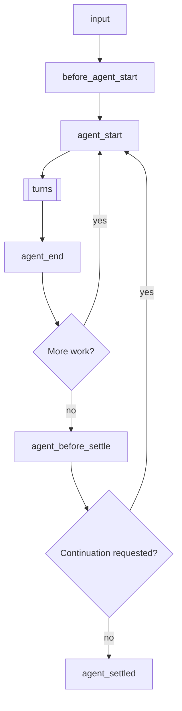
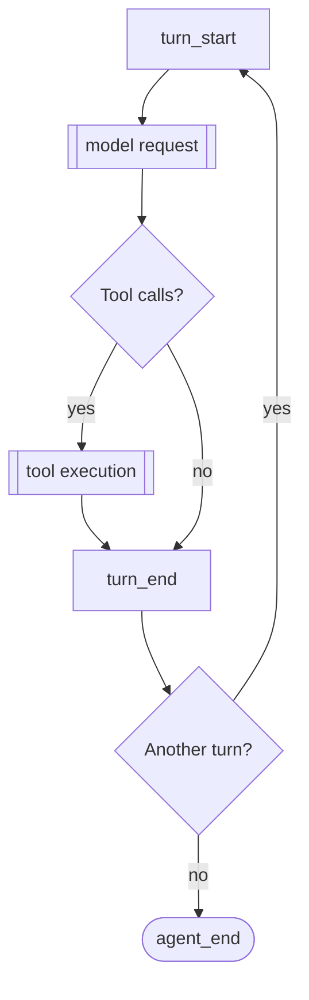
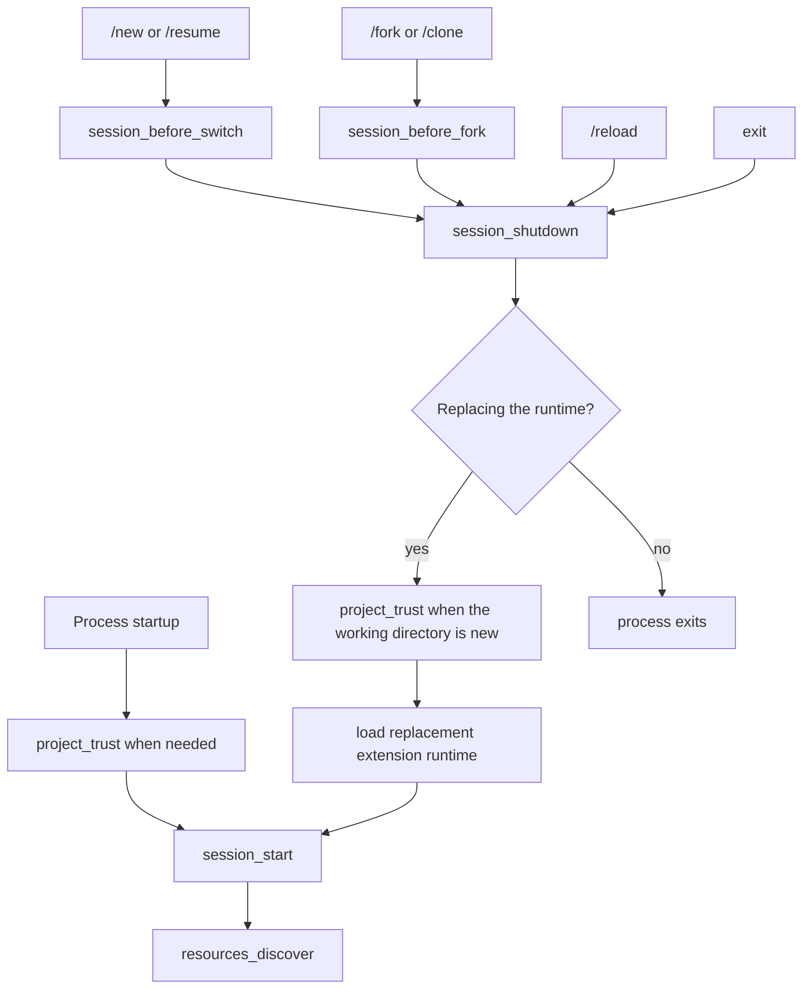

> Pi 可以创建扩展。告诉它你的使用场景，让它为你构建一个扩展。

# 扩展

扩展是用于扩展 Pi 行为的 TypeScript 模块。它们可以订阅生命周期事件、注册可供 LLM 调用的自定义工具、添加命令等。

扩展在 Pi 进程内运行，并拥有相同的操作系统权限。它可以查看提示词、工具调用、文件、凭据和会话历史，因此只应加载来自可信来源的扩展。

> **/reload 的放置位置：** 将扩展放在 `~/.pi/agent/extensions/`（全局）或 `.pi/extensions/`（项目本地），以便自动发现。`pi -e ./path.ts` 仅用于快速测试。自动发现位置中的扩展可以通过 `/reload` 热重载。

**主要能力：**
- **自定义工具** - 通过 `pi.registerTool()` 注册可由 LLM 调用的工具
- **事件拦截** - 阻止或修改工具调用、注入上下文、自定义压缩
- **用户交互** - 通过 `ctx.ui`（select、confirm、input、notify）向用户显示提示
- **自定义 UI 组件** - 通过 `ctx.ui.custom()` 构建支持键盘输入的完整 TUI 组件，以实现复杂交互
- **自定义命令** - 通过 `pi.registerCommand()` 注册类似 `/mycommand` 的命令
- **会话持久化** - 通过 `pi.appendEntry()` 存储可在重启后保留的状态
- **自定义渲染** - 控制工具调用/结果和消息在 TUI 中的显示方式
- **提供方和 MCP 服务器** - 注册模型提供方、虚拟模型和 MCP 服务器

**示例用途：**
- 权限门控（在执行 `rm -rf`、`sudo` 等命令前进行确认）
- Git 检查点（每轮暂存更改，并在分支上恢复）
- 路径保护（阻止写入 `.env`、`node_modules/`）
- 自定义压缩（按自己的方式总结对话）
- 对话摘要（参见 `summarize.ts` 示例）
- 交互式工具（问题、向导、自定义对话框）
- 有状态工具（待办列表、连接池）
- 外部集成（文件监视器、webhook、CI 触发器）
- 等待时玩的游戏（参见 `snake.ts` 示例）

可运行的实现请参见 [examples/extensions/](../../examples/extensions/)。

## 目录

- [快速开始](#quick-start)
- [扩展位置](#extension-locations)
- [可用导入](#available-imports)
- [编写扩展](#writing-an-extension)
  - [扩展形式](#extension-styles)
- [事件](#events)
  - [生命周期概览](#lifecycle-overview)
  - [处理器组合](#handler-composition)
  - [启动事件](#startup-events)
  - [资源事件](#resource-events)
  - [会话事件](#session-events)
  - [Agent 事件](#agent-events)
  - [模型事件](#model-events)
  - [工具事件](#tool-events)
  - [用户 Bash 事件](#user-bash-events)
  - [输入事件](#input-events)
- [ExtensionContext](#extensioncontext)
- [ExtensionCommandContext](#extensioncommandcontext)
- [ExtensionAPI 方法](#extensionapi-methods)
- [状态管理](#state-management)
- [自定义工具](#custom-tools)
  - [工具暴露方式](#tool-exposure)
  - [调用其他工具](#calling-other-tools)
  - [动态加载工具](#dynamic-tool-loading)
- [MCP 服务器](#mcp-servers)
- [自定义 UI](#custom-ui)
- [错误处理](#error-handling)
- [模式行为](#mode-behavior)
- [示例索引](#examples-reference)

<a id="create-an-extension"></a>

## 快速开始 <a id="quick-start"></a>

创建 `~/.pi/agent/extensions/my-extension.ts`：

```typescript
import { type ExtensionAPI, isToolCallEventType } from "@earendil-works/pi-coding-agent";
import { Type } from "typebox";

export default function (pi: ExtensionAPI) {
  // React to events
  pi.on("session_start", async (_event, ctx) => {
    ctx.ui.notify("Extension loaded!", "info");
  });

  pi.on("tool_call", async (event, ctx) => {
    if (isToolCallEventType("bash", event) && event.input.command.includes("rm -rf")) {
      const ok = await ctx.ui.confirm("Dangerous!", "Allow rm -rf?");
      if (!ok) return { block: true, reason: "Blocked by user" };
    }
  });

  // Register a custom tool
  pi.registerTool({
    name: "greet",
    label: "Greet",
    description: "Greet someone by name",
    parameters: Type.Object({
      name: Type.String({ description: "Name to greet" }),
    }),
    async execute(toolCallId, params, signal, onUpdate, ctx) {
      return {
        content: [{ type: "text", text: `Hello, ${params.name}!` }],
        details: {},
      };
    },
  });

  // Register a command
  pi.registerCommand("hello", {
    description: "Say hello",
    handler: async (args, ctx) => {
      ctx.ui.notify(`Hello ${args || "world"}!`, "info");
    },
  });
}
```

使用 `--extension`（或 `-e`）标志进行测试：

```bash
pi -e ./my-extension.ts
```

<a id="choose-where-it-loads"></a>

## 扩展位置 <a id="extension-locations"></a>

> **安全：** 扩展拥有完整的系统权限，可以执行任意代码。只从可信来源安装扩展。

扩展会从可信位置自动发现。项目本地 `.pi/extensions` 中的扩展只有在项目受信任后才会加载。

| 位置 | 范围 |
|----------|-------|
| `~/.pi/agent/extensions/*.ts` 或 `*.js` | 全局（所有项目） |
| `~/.pi/agent/extensions/*/index.ts` 或 `index.js` | 全局（子目录） |
| 含有 `pi.extensions` 字段的 `~/.pi/agent/extensions/*/package.json` | 全局（带清单的子目录） |
| `.pi/extensions/...` | 项目本地，布局相同 |

自动发现最多深入一层目录。较大的包会在 `package.json` 清单中声明入口点。

通过 `settings.json` 添加其他路径：

```json
{
  "packages": [
    "npm:@foo/bar@1.0.0",
    "git:github.com/user/repo@v1"
  ],
  "extensions": [
    "/path/to/local/extension.ts",
    "/path/to/local/extension/dir"
  ]
}
```

设置还接受 `builtin:<name>` 形式的内置扩展条目；参见[设置](settings.md#resources)。如需通过 npm 或 git 将扩展作为 Pi 包共享，请参见 [packages.md](packages.md)。

## 可用导入 <a id="available-imports"></a>

| 包 | 用途 |
|---------|---------|
| `@earendil-works/pi-coding-agent` | 扩展类型（`ExtensionAPI`、`ExtensionContext`、事件）和辅助函数 |
| `@earendil-works/pi-agent-core` | Agent 消息和工具类型 |
| `typebox`、`typebox/compile`、`typebox/value` | 工具参数的 schema 定义 |
| `@earendil-works/pi-ai` | AI 工具（用于字符串枚举的 `StringEnum`、转录辅助函数、模型类型）。在 Pi 内部，它还会导出 TypeBox 的 `Type`、`Static` 和 `TSchema`；已发布的包不再重新导出这些类型，新代码请从 `typebox` 导入 |
| `@earendil-works/pi-ai/compat`、`/models`、`/oauth`、`/providers/all` | 提供方构造、内置 API 和 OAuth 辅助函数 |
| `@earendil-works/pi-tui` | 用于自定义渲染的 TUI 组件 |

Pi 会将这些导入映射到自身的副本，因此扩展与 Pi 共用相同的类和注册表。旧版名称 `@mariozechner/*` 和 `@sinclair/typebox` 也会映射到相同模块。

npm 依赖也可用。将 `package.json` 放在扩展旁边（或某个父目录中），运行 `npm install`，即可自动解析来自 `node_modules/` 的导入。

对于通过 `pi install`（npm 或 git）安装的 Pi 分发包，运行时依赖必须列在 `dependencies` 中；`devDependencies` 不会安装。不要将上面由宿主提供的包列入 `dependencies`。参见[声明依赖](packages.md#declare-dependencies)。

### 工具参数 schema 与 TypeBox

Pi 使用 `@earendil-works/pi-schema` 将工具参数作为 JSON Schema 进行验证，无论 schema 是由什么构建的；TypeBox schema 本身就是 JSON Schema，可以直接使用。验证前会对类型较宽松的参数进行强制转换：数字字符串转为数字，`"true"` 转为 `true`，单个值转为只含一个元素的数组，可选属性中的 `null` 则会被移除。JSON Schema 以外的 TypeBox 特性不适用于工具参数：

- 不会运行 `Type.Refine()` 的细化检查。此类约束应在 `execute()` 中检查。
- `Type.BigInt()`、`Type.Undefined()` 和 `Type.Void()` 会拒绝所有参数，因为 JSON 不支持这些值。编解码器（`Type.Codec()`）不会解码：`execute()` 接收到的是 JSON 值。
- 不会检查通过 TypeBox 的 `Format.Set()` 注册的格式。标准格式会检查，此外还包括 `url` 和 `json-pointer-uri-fragment`。
- 属性名按名称匹配，而不是按正则表达式匹配；`additionalProperties` 只适用于对象中未声明的属性。
- 如果 `$ref` 指向不存在的定义，只会拒绝其所在位置的参数。

模型看到的验证错误使用 pi-schema 的消息，例如 `- path: missing` 或 `- limit: expected number, got string`。

也可以使用 Node.js 内置模块（`node:fs`、`node:path` 等）。

## 编写扩展 <a id="writing-an-extension"></a>

扩展会导出一个接收 `ExtensionAPI` 的默认工厂函数。工厂函数可以是同步的，也可以是异步的：

```typescript
import type { ExtensionAPI } from "@earendil-works/pi-coding-agent";

export default function (pi: ExtensionAPI) {
  // Subscribe to events
  pi.on("event_name", async (event, ctx) => {
    // ctx.ui for user interaction
    const ok = await ctx.ui.confirm("Title", "Are you sure?");
    ctx.ui.notify("Done!", "info");
    ctx.ui.setStatus("my-ext", "Processing...");  // Footer status
    ctx.ui.setWidget("my-ext", ["Line 1", "Line 2"]);  // Widget above editor (default)
  });

  // Register tools, commands, shortcuts, flags
  pi.registerTool({ ... });
  pi.registerCommand("name", { ... });
  pi.registerShortcut("ctrl+x", { ... });
  pi.registerFlag("my-flag", { ... });
}
```

扩展通过 [jiti](https://github.com/unjs/jiti) 加载，因此无需编译即可使用 TypeScript。

如果工厂函数返回 `Promise`，Pi 会等待它完成后再继续启动。因此，异步初始化会在 `session_start`、`resources_discover` 触发之前，以及通过 `pi.registerProvider()` 排队的提供方注册生效之前完成。

### 异步工厂函数

对于只需在启动时执行一次的工作，例如获取远程配置或动态发现可用模型，可以使用异步工厂函数。

```typescript
import type { ExtensionAPI } from "@earendil-works/pi-coding-agent";

export default async function (pi: ExtensionAPI) {
  const response = await fetch("http://localhost:1234/v1/models");
  const payload = (await response.json()) as {
    data: Array<{
      id: string;
      name?: string;
      context_window?: number;
      max_tokens?: number;
    }>;
  };

  pi.registerProvider("local-openai", {
    baseUrl: "http://localhost:1234/v1",
    apiKey: "$LOCAL_OPENAI_API_KEY",
    api: "openai-completions",
    models: payload.data.map((model) => ({
      id: model.id,
      name: model.name ?? model.id,
      reasoning: false,
      input: ["text"],
      cost: { input: 0, output: 0, cacheRead: 0, cacheWrite: 0 },
      contextWindow: model.context_window ?? 128000,
      maxTokens: model.max_tokens ?? 4096,
    })),
  });
}
```

此模式会让获取到的模型在正常启动期间以及 `pi --list-models` 中可用。如果模型列表会在 Pi 运行期间变化，则应改为实现 `refreshModels`；参见 [pi.registerProvider()](#piregisterprovidername-config)。

### 长生命周期资源与关闭

扩展工厂函数可能在不会启动会话的调用中运行。不要在工厂函数中启动进程、套接字、文件监视器或计时器等后台资源。

请将后台资源的启动推迟到 `session_start` 或实际需要该资源的命令/工具/事件中。注册一个幂等的 `session_shutdown` 处理器，以关闭你启动的会话级资源。

### 扩展形式 <a id="extension-styles"></a>

**单文件** - 最简单，适合小型扩展：

```
~/.pi/agent/extensions/
└── my-extension.ts
```

**含 index.ts 的目录** - 适用于多文件扩展：

```
~/.pi/agent/extensions/
└── my-extension/
    ├── index.ts        # Entry point (exports default function)
    ├── tools.ts        # Helper module
    └── utils.ts        # Helper module
```

**带依赖的包** - 适用于需要 npm 包的扩展：

```
~/.pi/agent/extensions/
└── my-extension/
    ├── package.json    # Declares dependencies and entry points
    ├── package-lock.json
    ├── node_modules/   # After npm install
    └── src/
        └── index.ts
```

```json
// package.json
{
  "name": "my-extension",
  "dependencies": {
    "zod": "^3.0.0",
    "chalk": "^5.0.0"
  },
  "pi": {
    "extensions": ["./src/index.ts"]
  }
}
```

在扩展目录中运行 `npm install` 后，即可自动使用来自 `node_modules/` 的导入。

<a id="extension-events"></a>

## 事件 <a id="events"></a>

<a id="understand-the-lifecycle"></a>

### 生命周期概览 <a id="lifecycle-overview"></a>

提示词会启动一次运行。首先处理输入：

1. 扩展命令（`/name`）会运行其处理器，不会触发 `input` 事件。键入的提示词和 RPC 提示词始终会检查命令；`pi.sendUserMessage()` 只有在 `expandPromptTemplates: true` 时才会检查。
2. `input` 处理器可以拦截、转换或处理文本。
3. 展开技能命令（`/skill:name`）和提示模板（`/template`）。
4. 运行 `before_agent_start`，随后启动 agent 循环。

这次运行会重复多个轮次，然后检查是否还有更多工作需要启动另一轮底层 agent 运行：



更多工作包括重试、最后一次尝试的恢复、压缩后重试或排队的消息。因此，`agent_end` 并不表示最终空闲；需要判断最终空闲状态时请使用 `agent_settled`。中止的运行会跳过 `agent_before_settle`，从 `agent_end` 直接进入 `agent_settled`。在运行启动期间（包括压缩检查和 `before_agent_start`）Pi 都会视为繁忙，因此此时发送的消息会进入正在启动的运行。

每个轮次会发送一次模型请求，并执行 assistant 回复中的工具调用：



模型请求会按以下顺序运行这些钩子：

1. `context`（可以修改对话消息）
2. `context_with_system`（可以修改完整转录）
3. `before_provider_headers`（可以修改标头）
4. `before_provider_request`（可以检查或替换载荷）
5. `after_provider_response`（在读取流之前处理状态码和标头）
6. `provider_stream_event`（原始解析后的流事件），以及 assistant 消息对应的 `message_start` / `message_update` / `message_end`

A 个实际执行的工具调用会按以下顺序运行这些钩子：

1. `tool_execution_start`
2. `tool_call`（可以阻止调用或修改输入）
3. 工具执行期间触发 `tool_execution_update`
4. `tool_result`（可以修改结果）
5. `tool_execution_end`

未执行的调用会提前结束。未知工具或无效参数会跳过 `tool_call`；被阻止或中止的调用会跳过执行和 `tool_result`。但这些调用仍会触发带有错误结果的 `tool_execution_end`，因此可用 `tool_execution_end` 观察每个已结束的调用。

`turn_end` 可以追加条目并请求继续运行。达到阈值时，会在自然需要的下一轮开始前执行压缩。消息事件也会针对其他消息触发，例如 user、tool-result 和自定义消息。只有当传输层提供相应阶段时，才会运行提供方钩子。

会话启动和替换遵循另一套生命周期：



`session_start` 携带 `reason: "startup" | "reload" | "new" | "resume" | "fork"`，而 `session_shutdown` 携带 `reason: "quit" | "reload" | "new" | "resume" | "fork"`。重新加载后，`resources_discover` 使用 `reason: "reload"`，其他情况使用 `"startup"`。退出包括 Ctrl+C、Ctrl+D、SIGHUP 和 SIGTERM。受信任项目资源加载前会运行 `project_trust`；会话替换进入新的工作目录时，该事件也可能再次运行。

其他操作会更改当前会话，但不会替换运行时：

| 操作 | 事件 |
|---|---|
| `/compact` 或自动压缩 | `session_before_compact`（可以取消或自定义），然后触发 `session_compact` 或 `session_compact_failed` |
| `/tree` 导航 | `session_before_tree`（可以取消或自定义），然后触发 `session_tree` |
| `/name` 或 `pi.setSessionName()` | `session_info_changed` |
| `/model` 或模型循环切换（`Ctrl+P`） | 如果思考级别发生变化或被限制，先触发 `thinking_level_select`，然后触发 `model_select` |
| 思考级别变化（设置、按键绑定、`pi.setThinkingLevel()`） | `thinking_level_select` |
| `!` 或 `!!` 命令 | `user_bash`（可以拦截） |
| 扩展对话框或自定义屏幕等待用户操作 | `ui_prompt_start`、`ui_prompt_end` |
| 空闲时刷新提示词缓存 | `cache_warming_decision` |
| 扩展在启动后注册或移除 MCP 服务器 | `mcp_servers_change` |

<a id="events-and-concurrency"></a>
<a id="work-with-events"></a>

### 处理器组合 <a id="handler-composition"></a>

处理器按扩展加载顺序运行；同一扩展中的处理器再按注册顺序运行。有些事件用于通知，有些则会转换数据、替换结果或取消操作：

| 模式 | 行为 |
|---|---|
| 通知 | 返回值会被忽略。该事件仅用于观察。 |
| 原地修改 | 后续处理器会看到诸如 `before_provider_headers.headers`、`before_agent_start.systemPromptOptions` 和 `tool_call.input` 等值的变化。 |
| 链式转换 | 后续处理器会收到先前 `input`、`context`、`context_with_system`、`message_end`、`tool_result` 和 `before_provider_request` 处理器返回的值。 |
| 门控 | 已处理的输入、被阻止的工具调用、被取消的会话操作，或已处理的 `user_bash` 命令，都会终止该操作的正常后备流程。 |
| 可操作边界 | 每个 `turn_end` 或 `agent_before_settle` 处理器都会看到目前提出的条目和继续运行决定。 |
| 最后一次覆盖 | 最后一个返回操作的 `cache_warming_decision` 处理器生效。 |

通知处理器不应在流式事件中执行耗时操作。转换处理器应保留不由其有意管理的字段；如果无法做出安全判断，门控处理器应默认阻止操作。

### 启动事件 <a id="startup-events"></a>

#### project_trust

在 Pi 决定是否信任包含动态配置（`.pi` 或 `.agents/skills`）的项目之前触发。它会在启动期间运行；会话替换（例如 `/resume`）进入当前进程中尚未确定信任状态的 cwd 时，也会运行。只有用户/全局扩展和 CLI `-e` 扩展会参与；项目本地扩展要等信任状态确定后才会加载。

```typescript
pi.on("project_trust", async (event, ctx) => {
  // event.cwd - current working directory
  // ctx has a limited trust context: cwd, mode, hasUI, and select/confirm/input/notify UI helpers
  if (await ctx.ui.confirm("Trust project?", event.cwd)) {
    return { trusted: "yes", remember: true };
  }
  return { trusted: "undecided" };
});
```

`project_trust` 处理器必须返回 `{ trusted: "yes" | "no" | "undecided" }`。返回 `"yes"` 或 `"no"` 的用户/全局或 CLI 扩展将负责做出决定；第一个 yes/no 决定优先，并会跳过内置的信任提示。使用 `remember: true` 持久化 yes/no 决定；否则该决定仅对当前进程有效。返回 `"undecided"` 可让后续处理器或内置信任流程做出决定。显示提示前请检查 `ctx.hasUI`。如果没有处理器返回 yes/no，则继续正常的信任解析：先应用已保存的 `trust.json` 决定，再由 `defaultProjectTrust` 控制 Pi 默认是询问、信任还是拒绝。

### 资源事件 <a id="resource-events"></a>

#### resources_discover

在 `session_start` 后触发，供扩展添加技能、提示词和主题路径。
启动时使用 `reason: "startup"`。重新加载时使用 `reason: "reload"`。

```typescript
pi.on("resources_discover", async (event, _ctx) => {
  // event.cwd - current working directory
  // event.reason - "startup" | "reload"
  return {
    skillPaths: ["/path/to/skills"],
    promptPaths: ["/path/to/prompts"],
    themePaths: ["/path/to/themes"],
  };
});
```

#### mcp_servers_change

扩展绑定后，有扩展注册或注销 MCP 服务器时触发。`event.servers` 会列出更改后的所有已注册服务器。处理此事件意味着该扩展负责连接已注册的服务器；参见 [MCP 服务器](#mcp-servers)。

### 会话事件 <a id="session-events"></a>

会话存储内部结构和 SessionManager API 请参见[会话格式](session-format.md)。

#### session_start

会话启动、加载或重新加载时触发。

```typescript
pi.on("session_start", async (event, ctx) => {
  // event.reason - "startup" | "reload" | "new" | "resume" | "fork"
  // event.previousSessionFile - present for "new", "resume", and "fork"
  ctx.ui.notify(`Session: ${ctx.sessionManager.getSessionFile() ?? "ephemeral"}`, "info");
});
```

#### session_info_changed

通过 `/name`、RPC 或 `pi.setSessionName()` 设置当前会话显示名称时触发。

```typescript
pi.on("session_info_changed", async (event, ctx) => {
  // event.name - current normalized name, or undefined if cleared
  ctx.ui.notify(`Session renamed: ${event.name ?? "(none)"}`, "info");
});
```

#### session_before_switch

开始新会话（`/new`）或切换会话（`/resume`）前触发。

```typescript
pi.on("session_before_switch", async (event, ctx) => {
  // event.reason - "new" or "resume"
  // event.targetSessionFile - session we're switching to (only for "resume")

  if (event.reason === "new") {
    const ok = await ctx.ui.confirm("Clear?", "Delete all messages?");
    if (!ok) return { cancel: true };
  }
});
```

成功切换或创建新会话后，Pi 会为旧扩展实例触发 `session_shutdown`，然后为新会话重新加载并重新绑定扩展，最后触发 `session_start`，其中 `reason` 为 `"new" | "resume"`，并包含 `previousSessionFile`。
在 `session_shutdown` 中执行清理工作，然后在 `session_start` 中恢复内存状态。

#### session_before_fork

通过 `/fork` 分叉或通过 `/clone` 克隆时触发。

```typescript
pi.on("session_before_fork", async (event, ctx) => {
  // event.entryId - ID of the selected entry
  // event.position - "before" for /fork, "at" for /clone
  return { cancel: true }; // Cancel fork/clone
  // OR
  return { skipConversationRestore: true }; // Reserved for future conversation restore control
});
```

成功分叉或克隆后，Pi 会为旧扩展实例触发 `session_shutdown`，然后为新会话重新加载并重新绑定扩展，最后触发 `session_start`，其中 `reason` 为 `"fork"`，并包含 `previousSessionFile`。
在 `session_shutdown` 中执行清理工作，然后在 `session_start` 中恢复内存状态。

<a id="session_before_compact--session_compact"></a>

#### session_before_compact / session_compact / session_compact_failed

压缩时触发。详情请参见 [compaction.md](compaction.md)。

```typescript
pi.on("session_before_compact", async (event, ctx) => {
  const { preparation, branchEntries, customInstructions, reason, willRetry, signal } = event;

  // reason - "manual" (/compact), "threshold", or "overflow"
  // willRetry - whether the aborted turn is retried after compaction (overflow recovery)

  // Cancel:
  return { cancel: true };

  // Custom summary:
  return {
    compaction: {
      summary: "...",
      firstKeptEntryId: preparation.firstKeptEntryId,
      tokensBefore: preparation.tokensBefore,
      // usage: summaryResponse.usage, // Optional; included in session totals
    }
  };
});

pi.on("session_compact", async (event, ctx) => {
  // event.compactionEntry - the saved compaction
  // event.fromExtension - whether extension provided it
  // event.reason - "manual" (/compact), "threshold", or "overflow"
  // event.willRetry - whether the aborted turn is retried after compaction (overflow recovery)
});

pi.on("session_compact_failed", async (event, ctx) => {
  // event.reason - "manual" (/compact), "threshold", or "overflow"
  // event.errorMessage - present for non-abort failures
  // event.aborted - true for cancelled/aborted compactions
  // event.willRetry - whether the aborted turn would have retried after compaction
  // event.fromExtension - whether extension-provided compaction content was being used
});
```

#### session_before_tree / session_tree

通过 `/tree` 导航时触发。树导航概念请参见[会话](sessions.md)。

```typescript
pi.on("session_before_tree", async (event, ctx) => {
  const { preparation, signal } = event;
  // preparation.targetId, oldLeafId, commonAncestorId, entriesToSummarize,
  // userWantsSummary, customInstructions, replaceInstructions, label
  return { cancel: true };
  // OR provide custom summary (used only when preparation.userWantsSummary is true):
  return {
    summary: {
      summary: "...",
      // usage: summaryResponse.usage, // Optional; included in session totals
      details: {},
    },
  };
  // OR override summarization options: customInstructions, replaceInstructions, label
});

pi.on("session_tree", async (event, ctx) => {
  // event.newLeafId, oldLeafId, summaryEntry, fromExtension
});
```

#### session_shutdown

已启动的会话运行时拆除前触发。可用它清理在 `session_start` 或其他会话级钩子中打开的资源。

```typescript
pi.on("session_shutdown", async (event, ctx) => {
  // event.reason - "quit" | "reload" | "new" | "resume" | "fork"
  // event.targetSessionFile - destination session for session replacement flows
  // Cleanup, save state, etc.
});
```

### Agent 事件 <a id="agent-events"></a>

#### before_agent_start

在输入处理和展开之后、运行开始之前触发。可以注入消息和/或修改系统提示词。

`event.messageType` 表示此次运行由什么启动：提示词或 `pi.sendUserMessage()` 对应 `"user"`，并包含 `prompt` 和 `images`；空闲时调用 `pi.sendMessage(..., { triggerTurn: true })` 对应 `"custom"`，并包含启动运行的 `message`，不含 `prompt`。

```typescript
pi.on("before_agent_start", async (event, ctx) => {
  // event.messageType - "user" | "custom"
  // event.prompt, event.images - user's prompt text and images (messageType "user")
  // event.message - the custom message that starts the run (messageType "custom")
  // event.systemPrompt - current chained system prompt for this handler
  //   (includes changes from earlier before_agent_start handlers)
  // event.systemPromptOptions - structured options used to build the system prompt
  //   .customPrompt - exact prompt prefix from --system-prompt, SYSTEM.md, or custom templates
  //   .forceSystemPrompt - optional exact replacement for the complete prompt
  //   .selectedTools - tools currently active in the prompt
  //   .hiddenTools - selected tools whose declarations requests leave out
  //   .toolSnippets - one-line descriptions for each tool
  //   .toolGuidelines - rule bullets keyed by tool name
  //   .promptGuidelines - additional custom rule bullets
  //   .sections - custom XML-wrapped sections keyed by tag name
  //   .appendSystemPrompt - text from --append-system-prompt flags
  //   .cwd - working directory
  //   .contextFiles - AGENTS.md files and other loaded context files
  //   .skills - loaded skills

  return {
    // Inject a persistent message (stored in session, sent to LLM)
    message: {
      customType: "my-extension",
      content: "Additional context for the LLM",
      display: true,
    },
    // Replace the system prompt for this turn (chained across extensions)
    systemPrompt: event.systemPrompt + "\n\nExtra instructions for this turn...",
  };
});
```

返回的 `message` 会添加到这两类运行中；检查 `messageType` 可跳过由自定义消息启动的运行。

`systemPromptOptions` 字段让扩展可以访问 Pi 用于构建系统提示词的同一份结构化数据。这些集合可以修改。建议修改 `sections`、`selectedTools` 或 `promptGuidelines`：Pi 会将生成的提示词分段与模型已有内容进行比较，并追加一条仅修补已更改分段的 system 消息。返回 `systemPrompt` 或设置 `forceSystemPrompt` 会替换本次运行的整个提示词：每个提供方都会收到这段强制文本作为开头的系统提示词（文本变化时缓存会失效），而会话转录仍会记录结构化分段。工具选择的更改会同时更新提示词内容和可执行的提供方工具；在处理器中调用 `pi.setActiveTools()` 与编辑 `selectedTools` 效果相同。支持在对话中途接收 system 消息的模型会就地收到补丁并保留缓存前缀；其他模型会将重新播放的提示词作为系统提示词，每次变化都会导致一次缓存未命中。

在 `before_agent_start` 处理器中，`event.systemPrompt` 和 `ctx.getSystemPrompt()` 都反映截至当前处理器的链式系统提示词。后续的 `before_agent_start` 处理器仍可继续修改它。

<a id="agent_start--agent_end--agent_settled"></a>

#### agent_start / agent_end / agent_before_settle / agent_settled

底层 agent 运行开始时触发 `agent_start`。该运行结束时触发 `agent_end`，但 Pi 之后仍可能自动重试、自动压缩后重试，或继续处理排队的后续消息。`agent_before_settle` 是最后一个可操作边界：它可以追加会话条目并请求继续一次。`agent_settled` 是最终的、仅用于通知的事件；需要知道 Pi 是否还会自动继续运行的状态集成应使用它。

```typescript
pi.on("agent_start", async (_event, ctx) => {});

pi.on("agent_end", async (event, ctx) => {
  // event.messages - messages from this low-level run
});

let addedReviewReminder = false;
pi.on("agent_before_settle", async (event, ctx) => {
  if (addedReviewReminder) return;
  addedReviewReminder = true;
  return {
    entries: [...event.entries, {
      type: "custom_message",
      customType: "review-reminder",
      content: "Review the final diff before replying.",
      display: false,
    }],
    continue: true,
  };
});

pi.on("agent_settled", async (event, ctx) => {
  // event.aborted - true when the run ended because it was aborted, for example with Escape
  // ctx.isIdle() is true; runs requested here start after all settled handlers finish.
});
```

如果运行在 `agent_before_settle` 处理器执行期间被中止，有效的返回条目仍会提交，但继续运行的请求会被抑制。`agent_settled` 请求的工作会延迟到所有 settled 处理器完成后执行，因此通知分发不会重入。

#### ui_prompt_start / ui_prompt_end

用于阻塞式、面向用户的扩展 UI 提示的生命周期通知事件。它们会在 `ctx.ui.select()`、`ctx.ui.confirm()`、`ctx.ui.input()`、`ctx.ui.editor()` 和 `ctx.ui.custom()` 前后触发，让宿主/状态集成可以显示“正在等待用户”，而不只是“正在运行”。

嵌套或重叠的提示会合并为一个最外层的等待区间。处理器会尽力调用，但显示或关闭提示前不会等待它们完成。

```typescript
pi.on("ui_prompt_start", async (event, ctx) => {
  // event.reason === "ui_prompt"
  // event.kind: "select" | "confirm" | "input" | "editor" | "custom"
  // event.title: prompt title when available
});

pi.on("ui_prompt_end", async (event, ctx) => {
  // Pi is no longer waiting on that UI prompt span.
});
```

#### turn_start / turn_end

每个轮次（一次 LLM 回复及工具调用）都会触发。

```typescript
pi.on("turn_start", async (event, ctx) => {
  // event.turnIndex, event.timestamp
});

let replacedResponse = false;
pi.on("turn_end", async (event, ctx) => {
  // event.turnIndex, event.message, event.toolResults
  // event.entries contains the structural entries proposed so far.
  if (replacedResponse || event.outcome !== "completed" || event.toolResults.length > 0) return;
  replacedResponse = true;
  return {
    entries: [
      ...event.entries,
      { type: "context_edit", targetId: event.messageEntryId, replacement: null },
      {
        type: "custom_message",
        customType: "replacement-instruction",
        content: "Answer again using the persisted user request.",
        display: false,
      },
    ],
    continue: true,
  };
});
```

`turn_end` 在 assistant 和工具结果消息持久化之后、底层 `turn_end` 事件之前运行。重试退避和最后一次尝试的恢复仍在 `agent_end` 之后进行，以保留现有生命周期和队列顺序；这些工作完成后，`agent_before_settle` 会看到修复后的投影。边界处理器按扩展加载顺序和注册顺序运行。每个处理器都会在 `event.entries` 中看到之前的提议，并看到据此重建的 `event.context`。返回 `entries` 或 `continue` 只会替换对应字段；未返回的字段保留当前提议。允许的草稿条目类型为 `custom`、`custom_message`、`context_edit` 和 `compaction`。所有处理器完成后，完整提议会先经过验证，再按列表顺序追加；处理器错误会被报告，但后续处理器仍会运行。验证可防止语义错误导致部分应用，但持久化过程并非事务性的。

`continue: true` 可确保该边界调用后恰好发出一次提供方请求。如果工具结果、steering 或后续消息已经会触发该请求，就视为满足此决定，不再额外请求；否则 Pi 会发出一次仅包含上下文的请求。错误和中止的回复仍会直接终止。`continue: false` 不会抑制自然产生的工作。请谨慎设置继续条件：无条件返回 `continue: true` 会在下次回复后再次评估，可能造成无限循环。`custom_message` 草稿会生成一条 user 角色的模型消息，但它由扩展编写，不会运行人工输入钩子、斜杠命令、技能或提示模板。

构造 `TurnEndEvent` 值的宿主集成必须提供 `messageEntryId`、`toolResultEntryIds`、`outcome`、`entries`、`continue` 和 `context`。`ExtensionEvent` 的穷尽式 switch 也必须处理 `agent_before_settle`。`ExtensionRunner.emit()` 不包含可操作的轮次边界；请通过 `emitBoundary(baseEvent, buildContext)` 分发 `turn_end` 和 `agent_before_settle`，以便处理器收到链式预览。其他专用 runner 方法仍会为 `session_before_*` 等事件返回结果。

#### message_start / message_update / message_end

消息生命周期更新时触发。

- `message_start` 和 `message_end` 会针对每条消息触发，包括 user、assistant、工具结果和自定义消息。
- assistant 流式更新时触发 `message_update`。
- `message_end` 处理器可以返回 `{ message }` 替换最终消息。替换后的消息必须保留相同的 `role`。

```typescript
pi.on("message_start", async (event, ctx) => {
  // event.message
});

pi.on("message_update", async (event, ctx) => {
  // event.message
  // event.assistantMessageEvent (token-by-token stream event)
});

pi.on("message_end", async (event, ctx) => {
  if (event.message.role !== "assistant") return;

  return {
    message: {
      ...event.message,
      usage: {
        ...event.message.usage,
        cost: {
          ...event.message.usage.cost,
          total: 0.123,
        },
      },
    },
  };
});
```

#### tool_execution_start / tool_execution_update / tool_execution_end

工具执行生命周期更新时触发。

并行工具模式下：
- `tool_execution_start` 在预检阶段按 assistant 源码顺序发出
- 不同工具的 `tool_execution_update` 事件可能交错出现
- 每个工具完成后，按工具完成顺序发出 `tool_execution_end`
- 最终的 `toolResult` 消息事件仍会稍后按 assistant 源码顺序发出

```typescript
pi.on("tool_execution_start", async (event, ctx) => {
  // event.toolCallId, event.toolName, event.args
});

pi.on("tool_execution_update", async (event, ctx) => {
  // event.toolCallId, event.toolName, event.args, event.partialResult
});

pi.on("tool_execution_end", async (event, ctx) => {
  // event.toolCallId, event.toolName, event.result, event.isError
  // event.durationMs - milliseconds execute() took; absent when the tool did not run
});
```

如果调用由另一个工具发起，这三个事件以及 `tool_call` 和 `tool_result` 都会携带 `parentToolCallId`；参见[调用其他工具](#calling-other-tools)。

#### context

每次 LLM 调用前触发。请以非破坏方式修改消息。消息类型请参见[会话格式](session-format.md)。

```typescript
pi.on("context", async (event, ctx) => {
  // event.messages - deep copy without system messages, safe to modify
  const filtered = event.messages.filter(m => !shouldPrune(m));
  return { messages: filtered };
});
```

`event.messages` 包含不带 system 消息的对话。提示词和工具声明属于 Pi，不属于此钩子：处理器返回更改后的列表时，Pi 会把当前提示词分段和工具声明重新放入一条开头的 system 消息，并置于返回消息之前。因此，从压缩摘要中筛选、截取窗口或切片都不会丢失提示词或工具。列表未改变时，对话中途的 system 消息会保留原位，因此支持这些消息的模型可以保留缓存前缀。处理器添加的 system 消息会放在 Pi 的开头消息之后。要持久更改提示词或工具集，请使用 [`before_agent_start`](#before_agent_start) 或 `pi.setActiveTools()`；要针对单次请求编辑 system 消息，请使用 [`context_with_system`](#context_with_system)。

#### context_with_system

在每次 LLM 调用前、所有 `context` 处理器运行完且 Pi 恢复提示词和工具状态后触发。`event.messages` 是完整转录，包含开头的 system 消息以及对话中途的提示词或工具补丁（参见[会话格式](session-format.md#sessionmessageentry)）。返回的消息会原样发送：此钩子负责管理本次请求的提示词和工具声明。

```typescript
import { getCurrentSystemMessage } from "@earendil-works/pi-ai";

pi.on("context_with_system", async (event, ctx) => {
  const cut = findCutIndex(event.messages);
  // Fold the dropped prefix so its prompt and tool state survives as the new head.
  const head = getCurrentSystemMessage(event.messages.slice(0, cut));
  return { messages: head ? [head, ...event.messages.slice(cut)] : event.messages.slice(cut) };
});
```

规则：索引 0 处必须保留 system 消息（提供方会从中读取提示词和初始工具声明；处理器删除该消息时 Pi 会报告错误）。删除 system 消息也会删除其中携带的工具声明和分段补丁。请使用 `@earendil-works/pi-ai` 中的 `getCurrentSystemPrompt()` 和 `getCurrentTools()` 检查输出。处理器按扩展加载顺序运行；`before_agent_start` 强制设置的 `systemPrompt` 仍会在之后映射到请求中。

#### before_provider_headers

传出的 HTTP 标头组装完成后触发。可用它添加、覆盖或移除请求标头。

处理器会原地修改 `event.headers`。将键设为字符串即可添加或覆盖标头，设为 `null` 则会删除标头。

```typescript
pi.on("before_provider_headers", (event, ctx) => {
  // Add or override — e.g. a session id for gateway tracing/attribution
  event.headers["x-session-id"] = ctx.sessionManager.getSessionId();

  // Drop a tracking header pi adds for this call
  event.headers["X-OpenRouter-Title"] = null;
});
```

每个提供方请求运行一次；重试会复用相同标头，不会再次触发此钩子。

#### before_provider_request

提供方专用载荷构建完成后、请求发送前触发。处理器按扩展加载顺序运行。返回 `undefined` 会保留载荷不变；返回其他值则会替换后续处理器及实际请求所用的载荷。

此钩子可以重写提供方级系统指令或将其完全移除。载荷级更改不会反映在 `ctx.getSystemPrompt()` 中；该方法返回 Pi 的系统提示词字符串，而不是最终序列化后的提供方载荷。

```typescript
pi.on("before_provider_request", (event, ctx) => {
  console.log(JSON.stringify(event.payload, null, 2));

  // Optional: replace payload
  // return { ...event.payload, temperature: 0 };
});
```

此钩子主要用于调试提供方序列化和缓存行为。

载荷是完整请求。对于从先前回复继续的提供方（通过 WebSocket 使用的 OpenAI Codex、Anthropic 消息线程），实际发送的可能只有相较上次请求新增的部分。

#### after_provider_response

收到 HTTP 响应后、读取其流式正文之前触发。处理器按扩展加载顺序运行。

```typescript
pi.on("after_provider_response", (event, ctx) => {
  // event.status - HTTP status code
  // event.headers - normalized response headers
  if (event.status === 429) {
    console.log("rate limited", event.headers["retry-after"]);
  }
});
```

标头是否可用取决于提供方和传输方式。对 HTTP 响应进行抽象处理的提供方可能不会公开标头。

#### provider_stream_event

Pi 对提供方流事件进行规范化之前，每解析一个事件都会触发。此事件仅用于通知，不会持久化。

```typescript
pi.on("provider_stream_event", (event, ctx) => {
  // event.provider, event.api, event.model
  // event.data - earliest structured value available to Pi (read-only)
});
```

`event.data` 不一定是原始 HTTP 字节或 SSE 帧。请将其视为只读，因为修改可能影响规范化。处理器会按流顺序等待，因此运行缓慢的处理器会延迟读取流。处理器错误会被报告，但不会改变提供方响应。可选的原始事件查看器会按 assistant 消息分组；参见 [`debug-provider.ts`](../../examples/extensions/debug-provider.ts)。

#### cache_warming_decision

每次刷新提示词缓存前触发，事件中已填入 Pi 的决定。该事件只包含 Pi 的成本估算；其他信息请使用 `ctx.model`、`ctx.isIdle()` 和 `ctx.getContextUsage()` 获取。

```typescript
pi.on("cache_warming_decision", (event, ctx) => {
  // event.warmCost: price of this refresh
  // event.missCost: extra price of the next request if the entry is lost
  // event.continuationProbability: pi's estimate that a request arrives in time
  // event.action: "warm" | "stop", pi's decision

  if (ctx.model?.provider === "my-provider") {
    return { action: "stop" };
  }
});
```

返回 `{ action: "warm" }` 或 `{ action: "stop" }` 即可覆盖决定；最后一个返回操作的处理器生效。`"stop"` 会停止预热，直到下一次实际请求到来。

### 模型事件 <a id="model-events"></a>

#### model_select

通过 `/model` 命令、模型循环切换（`Ctrl+P`）或 `pi.setModel()` 更改模型时触发。恢复会话时不会触发；请在 `session_start` 中读取 `ctx.model` 来初始化依赖模型的状态。

```typescript
pi.on("model_select", async (event, ctx) => {
  // event.model - newly selected model
  // event.previousModel - previous model (undefined if first selection)
  // event.source - "set" | "cycle"

  const prev = event.previousModel
    ? `${event.previousModel.provider}/${event.previousModel.id}`
    : "none";
  const next = `${event.model.provider}/${event.model.id}`;

  ctx.ui.notify(`Model changed (${event.source}): ${prev} -> ${next}`, "info");
});
```

活动模型改变时，可用此事件更新 UI 元素（状态栏、页脚）或执行特定于模型的初始化。

#### thinking_level_select

思考级别改变时触发。此事件仅用于通知；处理器的返回值会被忽略。

```typescript
pi.on("thinking_level_select", async (event, ctx) => {
  // event.level - newly selected thinking level
  // event.previousLevel - previous thinking level

  ctx.ui.setStatus("thinking", `thinking: ${event.level}`);
});
```

`pi.setThinkingLevel()`、模型更改或内置思考级别控件改变当前思考级别时，可用此事件更新扩展 UI。

<a id="tool-call-events"></a>

### 工具事件 <a id="tool-events"></a>

#### tool_call

在 `tool_execution_start` 之后、工具执行之前触发。**可以阻止调用。** 使用 `isToolCallEventType` 缩小类型范围并获取带类型的输入。

运行 `tool_call` 之前，Pi 会等待先前发出的 Agent 事件经由 `AgentSession` 完成处理。这意味着 `ctx.sessionManager` 已同步到当前 assistant 工具调用消息。

在默认的并行工具执行模式下，同一 assistant 消息中的同级工具调用会先按顺序预检，再并发执行。无法保证 `tool_call` 能在 `ctx.sessionManager` 中看到该 assistant 消息中同级工具的结果。

`event.input` 可以修改。可在执行前原地修改它来调整工具参数。

行为保证：
- 对 `event.input` 的修改会影响实际工具执行
- 后续 `tool_call` 处理器会看到先前处理器所做的修改
- 修改后不会重新验证参数
- `tool_call` 的返回值通过 `{ block: true, reason?: string, terminate?: boolean }` 控制是否阻止调用
- `terminate` 仅适用于被阻止的调用；只有批次中所有已结束结果都设置了终止标志，agent 才会提前停止

```typescript
import { isToolCallEventType } from "@earendil-works/pi-coding-agent";

pi.on("tool_call", async (event, ctx) => {
  // event.toolName - "bash", "read", "write", "edit", etc.
  // event.toolCallId
  // event.input - tool parameters (mutable)

  // Built-in tools: no type params needed
  if (isToolCallEventType("bash", event)) {
    // event.input is { command: string; timeout?: number }
    event.input.command = `source ~/.profile\n${event.input.command}`;

    if (event.input.command.includes("rm -rf")) {
      return { block: true, reason: "Dangerous command", terminate: true };
    }
  }

  if (isToolCallEventType("read", event)) {
    // event.input is { path: string; offset?: number; limit?: number }
    console.log(`Reading: ${event.input.path}`);
  }
});
```

#### 为自定义工具输入指定类型

自定义工具应导出其输入类型：

```typescript
// my-tool.ts
import { type Static, Type } from "typebox";

export const myToolSchema = Type.Object({ action: Type.String() });
export type MyToolInput = Static<typeof myToolSchema>;
```

使用带有显式类型参数的 `isToolCallEventType`：

```typescript
import { isToolCallEventType } from "@earendil-works/pi-coding-agent";
import type { MyToolInput } from "./my-tool.ts";

pi.on("tool_call", (event) => {
  if (isToolCallEventType<"my_tool", MyToolInput>("my_tool", event)) {
    event.input.action;  // typed
  }
});
```

#### tool_result

工具执行完成后、`tool_execution_end` 和最终工具结果消息事件发出前触发。**可以修改结果。**

在并行工具模式下，`tool_result` 和 `tool_execution_end` 可能按工具完成顺序交错出现，而最终的 `toolResult` 消息事件仍会在稍后按 assistant 源码顺序发出。

`tool_result` 处理器按中间件方式链式运行：
- 处理器按扩展加载顺序运行
- 每个处理器都会看到先前处理器更改后的最新结果
- 处理器可以返回部分补丁（`content`、`details`、`structuredContent`、`isError` 或 `usage`）；未提供的字段保留当前值
- 替换 `content` 时若未同时返回 `structuredContent`，结构化内容会被丢弃，因为它可能已不再匹配

在处理器中执行嵌套异步工作时请使用 `ctx.signal`。这样按 Esc 就可以取消扩展启动的模型调用、`fetch()` 及其他支持中止的操作。

```typescript
import { isBashToolResult } from "@earendil-works/pi-coding-agent";

pi.on("tool_result", async (event, ctx) => {
  // event.toolName, event.toolCallId, event.input, event.parentToolCallId
  // event.content, event.details, event.structuredContent, event.isError, event.usage

  if (isBashToolResult(event)) {
    // event.details is typed as BashToolDetails
  }

  const response = await fetch("https://example.com/summarize", {
    method: "POST",
    body: JSON.stringify({ content: event.content }),
    signal: ctx.signal,
  });

  // Modify result:
  return { content: [...], details: {...}, isError: false, usage: nestedModelUsage };
});
```

### 用户 Bash 事件 <a id="user-bash-events"></a>

#### user_bash

用户执行 `!` 或 `!!` 命令时触发。**可以拦截。**

```typescript
import { createLocalBashOperations } from "@earendil-works/pi-coding-agent";

pi.on("user_bash", (event, ctx) => {
  // event.command - the bash command
  // event.excludeFromContext - true if !! prefix
  // event.cwd - working directory

  // Option 1: Provide custom operations (e.g., SSH)
  return { operations: remoteBashOps };

  // Option 2: Wrap pi's built-in local bash backend
  const local = createLocalBashOperations();
  return {
    operations: {
      exec(command, cwd, options) {
        return local.exec(`source ~/.profile\n${command}`, cwd, options);
      }
    }
  };

  // Option 3: Full replacement - return result directly
  return { result: { output: "...", exitCode: 0, cancelled: false, truncated: false } };
});
```

返回 `undefined` 会继续交给下一个处理器；若没有处理器接手，则在本地执行。返回有效结果会停止传播：`operations` 会通过提供的后端执行命令，而 `result` 会记录已完成的命令但不实际执行。

### 输入事件 <a id="input-events"></a>

#### input

收到用户输入后、检查扩展命令之后、展开技能和模板之前触发。此事件看到的是原始输入文本，因此 `/skill:foo` 和 `/template` 尚未展开。

**处理顺序：**
1. 首先检查扩展命令（`/cmd`）；如果找到，则运行处理器并跳过 input 事件。只有设置 `expandPromptTemplates: true` 时，才会检查来自 `pi.sendUserMessage()` 的消息。
2. 触发 `input` 事件，可进行拦截、转换或处理。
3. 如果未处理：展开技能命令（`/skill:name`），替换为技能内容。
4. 如果未处理：展开提示模板（`/template`），替换为模板内容。
5. 开始 agent 处理（`before_agent_start` 等）。

```typescript
pi.on("input", async (event, ctx) => {
  // event.text - raw input (before skill/template expansion)
  // event.images - attached images, if any
  // event.source - "interactive" (typed), "rpc" (API), or "extension" (via sendUserMessage)
  // event.streamingBehavior - "steer" | "followUp" | undefined
  //   undefined when idle, "steer" for mid-stream interrupts,
  //   "followUp" for messages queued until the agent finishes

  // Transform: rewrite input before expansion
  if (event.text.startsWith("?quick "))
    return { action: "transform", text: `Respond briefly: ${event.text.slice(7)}` };

  // Handle: respond without LLM (extension shows its own feedback)
  if (event.text === "ping") {
    ctx.ui.notify("pong", "info");
    return { action: "handled" };
  }

  // Route by source: skip processing for extension-injected messages
  if (event.source === "extension") return { action: "continue" };

  // Intercept skill commands before expansion
  if (event.text.startsWith("/skill:")) {
    // Could transform, block, or let pass through
  }

  return { action: "continue" };  // Default: pass through to expansion
});
```

**结果：**
- `continue` - 不作更改，继续传递（处理器无返回值时的默认行为）
- `transform` - 修改文本/图像，然后继续展开
- `handled` - 完全跳过 agent（第一个返回此值的处理器生效）

转换会在各处理器之间链式传递。有关根据 `streamingBehavior` 进行路由的示例，请参见 [input-transform.ts](../../examples/extensions/input-transform.ts) 和 [input-transform-streaming.ts](../../examples/extensions/input-transform-streaming.ts)。

<a id="use-extension-context"></a>

## ExtensionContext

所有处理器都会收到 `ctx: ExtensionContext`。工具的 `execute()` 会收到 `ExtensionToolContext`，其中增加了 `ctx.tools` 和 `ctx.executeTool()`（参见[调用其他工具](#calling-other-tools)）。命令处理器会收到 [`ExtensionCommandContext`](#extensioncommandcontext)。

### ctx.ui

用于用户交互的 UI 方法。详情请参见[自定义 UI](#custom-ui)。

### ctx.mode

当前运行模式：`"tui"`、`"rpc"`、`"json"` 或 `"print"`。可使用 `ctx.mode === "tui"` 限制仅终端功能，例如 `custom()`、组件工厂、终端输入和直接 TUI 渲染。

### ctx.hasUI

在 TUI 和 RPC 模式下为 `true`；在 print 模式（`-p`）和 JSON 模式下为 `false`。可用它检查同时适用于 TUI 和 RPC 模式的对话框方法（`select`、`confirm`、`input`、`editor`）以及即发即弃方法（`notify`、`setStatus`、`setWidget`、`setTitle`、`setEditorText`）。在 RPC 模式下，某些 TUI 专用方法不会执行任何操作或会返回默认值（参见 [RPC 扩展 UI](rpc-extension-ui.md)）。

### ctx.cwd

当前工作目录。

构造项目本地配置路径时，请使用 `CONFIG_DIR_NAME`，不要将 `.pi` 硬编码。重新命名的发行版可能会使用不同的配置目录名称。

```typescript
import { CONFIG_DIR_NAME, type ExtensionAPI } from "@earendil-works/pi-coding-agent";
import { join } from "node:path";

export default function (pi: ExtensionAPI) {
  pi.on("session_start", (_event, ctx) => {
    const projectConfigPath = join(ctx.cwd, CONFIG_DIR_NAME, "my-extension.json");
    // ...
  });
}
```

### ctx.isProjectTrusted()

返回当前会话上下文是否启用了项目本地信任。这包括临时信任决定和 CLI 信任覆盖，不仅限于全局信任存储中保存的决定。

读取仅应在受信任项目中生效的项目本地扩展配置前，请先使用此方法。

### ctx.sessionManager

以只读方式访问会话状态：`getCwd()`、`getSessionDir()`、`getSessionId()`、`getSessionFile()`、`getSessionName()`、`getHeader()`、`getEntries()`、`getEntry()`、`getBranch()`、`getTree()`、`getLeafId()`、`getLeafEntry()`、`getLabel()`、`buildContextEntries()` 和 `buildSessionProjection()`。条目类型请参见[会话格式](session-format.md)。

对于 `tool_call`，此状态会在处理器运行前同步到当前 assistant 消息。在并行工具执行模式下，仍不能保证其中包含同一 assistant 消息中同级工具的结果。

```typescript
ctx.sessionManager.getEntries()             // All entries
ctx.sessionManager.getBranch()              // Current branch
ctx.sessionManager.buildContextEntries()    // Active branch entries with compaction applied
ctx.sessionManager.getLeafId()              // Current leaf entry ID
```

### ctx.modelRegistry / ctx.model / ctx.thinkingLevel / ctx.scopedModels

用于访问模型、提供方和已解析的身份验证。`ctx.modelRegistry.getProvider(id)` 返回当前生效的 pi-ai 提供方；`getProviderAuth(id)` 无需加载模型即可解析其当前 API 密钥、标头、基础 URL 和提供方作用域环境。`ctx.model` 是当前活动模型，`ctx.thinkingLevel` 是该模型当前生效的思考级别。

`ctx.scopedModels` 是限定在当前会话范围内的只读模型列表，与 `/scoped-models` 命令显示的集合相同。会话启动时，它会根据 `--models` CLI 标志和 `enabledModels` 设置解析（使用 minimatch 按 `provider/modelId` 或单独的 `modelId` 与可用目录匹配）。未配置范围时列表为空，表示所有可用模型均可使用。每个条目的形式为 `{ model, thinkingLevel? }`；只有模式固定了思考级别时才会设置 `thinkingLevel`（例如 `anthropic/*:high`）。可用它填充与内置模型选择器一致的模型列表，避免通过 `ctx.modelRegistry.getAvailable()` 枚举整个目录。

#### 流式模型调用

对于 `reasoning` 等与提供方无关的选项，请使用 `ctx.modelRegistry.streamSimple(model, context, options)`；需要使用特定于 API 的选项并等待最终 assistant 消息时，请使用 `complete(model, context, options)`。两者都会使用已配置的提供方并解析身份验证，包括通过 `pi.registerProvider()` 注册的提供方。请使用这些方法，不要使用 `pi-ai/compat` 流式函数，后者无法看到扩展注册的提供方。

`streamSimple()` 会返回 `AssistantMessageEventStream`。遍历它以读取回复事件，并等待 `.result()` 获取最终消息。初始化失败会产生错误事件和错误结果。

对于非聊天模型，`findOfType()`、`getModelsOfType()`、`getAvailableOfType()` 和 `getModelOfType()` 可查找图像模型和分类器模型，`classify()` 和 `generateImages()` 则会调用这些模型。参见[使用分类器模型](models.md#use-classifier-models)和[使用图像模型](models.md#use-image-models)。

### ctx.signal

当前 agent 的中止信号；没有正在进行的 agent 轮次时为 `undefined`。

扩展处理器启动的嵌套工作若需支持中止，请使用此信号，例如：
- `fetch(..., { signal: ctx.signal })`
- 接受 `signal` 的模型调用
- 接受 `AbortSignal` 的文件或进程辅助函数

`ctx.signal` 通常会在 `tool_call`、`tool_result`、`message_update` 和 `turn_end` 等活动轮次事件中定义。
在空闲或非轮次上下文中通常为 `undefined`，例如会话事件、扩展命令以及 Pi 空闲时触发的快捷键。

```typescript
pi.on("tool_result", async (event, ctx) => {
  const response = await fetch("https://example.com/api", {
    method: "POST",
    body: JSON.stringify(event),
    signal: ctx.signal,
  });

  const data = await response.json();
  return { details: data };
});
```

### ctx.isIdle() / ctx.abort() / ctx.hasPendingMessages()

控制流程辅助方法。Pi 正在处理 agent 运行、自动重试、自动压缩后重试或排队的后续任务时，`ctx.isIdle()` 会返回 false。

### ctx.shutdown()

请求平稳关闭 pi。

- **交互模式：** 延迟到 agent 空闲后执行（即所有排队的 steering 和后续消息处理完毕后）。
- **RPC 模式：** 会话空闲且没有正在处理的命令时立即执行；否则延迟到当前命令（包括其响应）结束或当前运行稳定后执行。（扩展启动的压缩正在运行时提出的请求，会等到下一个命令或运行结束后再执行。）
- **Print 模式：** 不执行任何操作。所有提示词处理完后进程会自动退出。

退出前会向所有扩展触发 `session_shutdown` 事件。所有上下文（事件处理器、工具、命令、快捷键）中都可使用。

```typescript
pi.on("tool_call", (event, ctx) => {
  if (isFatal(event.input)) {
    ctx.shutdown();
  }
});
```

### ctx.getContextUsage()

返回当前活动模型的上下文用量。如果有最近一条 assistant 消息的用量数据，就使用该数据；否则会估算尾部消息的 token 数。

```typescript
const usage = ctx.getContextUsage();
if (usage?.tokens != null && usage.tokens > 100_000) {
  // ...
}
```

### ctx.compact()

触发压缩但不等待完成。后续操作请使用 `onComplete` 和 `onError`。

```typescript
ctx.compact({
  customInstructions: "Focus on recent changes",
  onComplete: (result) => {
    ctx.ui.notify("Compaction completed", "info");
  },
  onError: (error) => {
    ctx.ui.notify(`Compaction failed: ${error.message}`, "error");
  },
});
```

### ctx.getSystemPrompt()

返回 Pi 当前的系统提示词字符串。

- 在 `before_agent_start` 期间，它反映本轮目前为止链式累积的系统提示词更改。
- 它不包含之后 `context` 对消息的修改。
- 它不包含 `before_provider_request` 对载荷的重写。
- 如果后加载的扩展在你的扩展之后运行，它们仍可能更改最终发送的内容。

```typescript
pi.on("before_agent_start", (event, ctx) => {
  const prompt = ctx.getSystemPrompt();
  console.log(`System prompt length: ${prompt.length}`);
});
```

## ExtensionCommandContext

命令处理器会收到 `ExtensionCommandContext`，它在 `ExtensionContext` 基础上增加了会话控制方法。这些方法仅能在命令中使用，因为从事件处理器中调用可能导致死锁。

### ctx.getSystemPromptOptions()

返回 Pi 当前用于构建系统提示词的基础输入。

```typescript
const options = ctx.getSystemPromptOptions();
const contextPaths = options.contextFiles?.map((file) => file.path) ?? [];
```

它的结构和可变性与 `before_agent_start` 的 `event.systemPromptOptions` 相同：包括自定义或强制提示词、活动工具、工具摘要、每个工具的规则和自定义规则、自定义分段、追加的提示词文本、cwd、已加载的上下文文件和已加载的技能。它可能包含上下文文件的完整内容，因此应视为敏感的扩展本地数据，避免通过命令列表、日志或自动补全元数据公开。

此方法报告当前的基础提示词输入。不包含每轮 `before_agent_start` 链式累积的系统提示词更改、之后 `context` 事件对消息的修改，也不包含 `before_provider_request` 对载荷的重写。

### ctx.waitForIdle()

等待 agent 完全稳定，包括自动重试、自动压缩后重试以及排队的后续任务：

```typescript
pi.registerCommand("my-cmd", {
  handler: async (args, ctx) => {
    await ctx.waitForIdle();
    // Agent is now idle, safe to modify session
  },
});
```

### ctx.newSession(options?)

创建新会话：

```typescript
const parentSession = ctx.sessionManager.getSessionFile();
const kickoff = "Continue in the replacement session";

const result = await ctx.newSession({
  parentSession,
  setup: async (sm) => {
    sm.appendMessage({
      role: "user",
      content: [{ type: "text", text: "Context from previous session..." }],
      timestamp: Date.now(),
    });
  },
  withSession: async (ctx) => {
    // Use only the replacement-session ctx here.
    await ctx.sendUserMessage(kickoff);
  },
});

if (result.cancelled) {
  // An extension cancelled the new session
}
```

选项：
- `parentSession`：记录在新会话头部中的父会话文件
- `setup`：在 `withSession` 运行前修改新会话的 `SessionManager`
- `withSession`：在新的替换会话上下文中执行切换后的工作。不要使用捕获的旧 `pi` / 命令 `ctx`；参见[会话替换生命周期与注意事项](#session-replacement-lifecycle-and-footguns)。

### ctx.fork(entryId, options?)

从指定条目分叉，创建新的会话文件：

```typescript
const result = await ctx.fork("entry-id-123", {
  withSession: async (ctx) => {
    // Use only the replacement-session ctx here.
    ctx.ui.notify("Now in the forked session", "info");
  },
});
if (result.cancelled) {
  // An extension cancelled the fork
}

const cloneResult = await ctx.fork("entry-id-456", { position: "at" });
if (cloneResult.cancelled) {
  // An extension cancelled the clone
}
```

Options:
- `position`：`"before"`（默认）在选中的 user 消息之前分叉，并将该提示词恢复到编辑器中
- `position`：`"at"` 复制经过选中条目的活动路径，但不恢复编辑器文本
- `withSession`：在新的替换会话上下文中执行切换后的工作。不要使用捕获的旧 `pi` / 命令 `ctx`；参见[会话替换生命周期与注意事项](#session-replacement-lifecycle-and-footguns)。

### ctx.navigateTree(targetId, options?)

导航到会话树中的另一位置。agent 正在回复、正在手动或自动压缩，或正在进行另一次树导航时，即使设置了 `summarize: false` 也会拒绝执行。这些冲突不会更改活动分支，而是拒绝 Promise，不会返回 `{ cancelled: true }`。等待当前操作结束（例如在命令处理器中调用 `await ctx.waitForIdle()`）后重试。未设置可用模型却启用了 `summarize`，或目标条目不存在时，此方法也会拒绝：

```typescript
const result = await ctx.navigateTree("entry-id-456", {
  summarize: true,
  customInstructions: "Focus on error handling changes",
  replaceInstructions: false, // true = replace default prompt entirely
  label: "review-checkpoint",
});
```

选项：
- `summarize`：是否为放弃的分支生成摘要
- `customInstructions`：提供给摘要器的自定义指令
- `replaceInstructions`：为 true 时，`customInstructions` 会替换默认提示词，而不是追加到其后
- `label`：附加到分支摘要条目的标签（未生成摘要时则附加到目标条目）

### ctx.switchSession(sessionPath, options?)

切换到另一个会话文件：

```typescript
const result = await ctx.switchSession("/path/to/session.jsonl", {
  withSession: async (ctx) => {
    await ctx.sendUserMessage("Resume work in the replacement session");
  },
});
if (result.cancelled) {
  // An extension cancelled the switch via session_before_switch
}
```

选项：
- `withSession`：在新的替换会话上下文中执行切换后的工作。不要使用捕获的旧 `pi` / 命令 `ctx`；参见[会话替换生命周期与注意事项](#session-replacement-lifecycle-and-footguns)。

要查找可用会话，请使用静态方法 `SessionManager.list()` 或 `SessionManager.listAll()`：

```typescript
import { SessionManager } from "@earendil-works/pi-coding-agent";

pi.registerCommand("switch", {
  description: "Switch to another session",
  handler: async (args, ctx) => {
    const sessions = await SessionManager.list(ctx.cwd);
    if (sessions.length === 0) return;
    const choice = await ctx.ui.select(
      "Pick session:",
      sessions.map((s) => s.path),
    );
    if (choice) {
      await ctx.switchSession(choice, {
        withSession: async (ctx) => {
          ctx.ui.notify("Switched session", "info");
        },
      });
    }
  },
});
```

### 会话替换生命周期与注意事项 <a id="session-replacement-lifecycle-and-footguns"></a>

`withSession` 会收到新的 `ReplacedSessionContext`。它扩展了 `ExtensionCommandContext`，并添加了绑定到替换会话的异步辅助方法 `sendMessage()` 和 `sendUserMessage()`。

生命周期和注意事项：
- 只有在旧会话触发 `session_shutdown`、旧运行时已拆除、替换会话已重新绑定且新的扩展实例已收到 `session_start` 后，`withSession` 才会运行。
- 回调仍在原闭包中执行，而不在新的扩展实例中执行。这意味着 `withSession` 启动前，旧扩展实例可能已经完成了关闭清理。
- 替换后，捕获的旧 `pi` / 旧命令 `ctx` 等会话绑定对象已过期，使用时会抛错。会话相关工作只能使用传给 `withSession` 的 `ctx`。
- 先前提取的原始对象仍由你负责管理。例如，若在替换前捕获了 `const sm = ctx.sessionManager`，`sm` 仍然是旧的 `SessionManager` 对象。替换后不要复用它。
- `withSession` 中的代码应假定 `session_shutdown` 处理器使其失效的状态都已清除。只捕获能够在关闭后妥善保留的普通数据，例如字符串、id 和序列化配置。

安全模式：

```typescript
pi.registerCommand("handoff", {
  handler: async (_args, ctx) => {
    const kickoff = "Continue from the replacement session";
    await ctx.newSession({
      withSession: async (ctx) => {
        await ctx.sendUserMessage(kickoff);
      },
    });
  },
});
```

不安全模式：

```typescript
pi.registerCommand("handoff", {
  handler: async (_args, ctx) => {
    const oldSessionManager = ctx.sessionManager;
    await ctx.newSession({
      withSession: async (_ctx) => {
        // stale old objects: do not do this
        oldSessionManager.getSessionFile();
        pi.sendUserMessage("wrong");
      },
    });
  },
});
```

### ctx.reload()

执行与 `/reload` 相同的重新加载流程。

```typescript
pi.registerCommand("reload-runtime", {
  description: "Reload extensions, skills, prompts, themes, and context files",
  handler: async (_args, ctx) => {
    await ctx.reload();
    return;
  },
});
```

重要行为：
- `await ctx.reload()` 会为当前扩展运行时触发 `session_shutdown`
- 随后会重新加载资源，并触发 `session_start`（`reason: "reload"`）和 `resources_discover`（原因是 `"reload"`）
- 当前正在运行的命令处理器仍会在旧调用帧中继续执行
- `await ctx.reload()` 之后的代码仍来自重新加载前的版本
- `await ctx.reload()` 之后的代码不得假设旧的扩展内存状态仍有效
- 处理器返回后，后续命令/事件/工具调用会使用新的扩展版本

为确保行为可预测，应将重新加载视为该处理器的终点（`await ctx.reload(); return;`）。

工具使用 `ExtensionToolContext`，而不是 `ExtensionCommandContext`，所以无法调用 `ctx.reload()`；并且 agent 运行期间 Pi 无法重新加载。若要让 LLM 触发重新加载，可以让工具记录请求，并在 `agent_settled` 中运行命令；该事件会等所有 settled 处理器完成后再处理处理器发送的消息：

```typescript
let reloadRequested = false;

pi.registerTool({
  name: "reload_runtime",
  label: "Reload Runtime",
  description: "Reload extensions, skills, prompts, themes, and context files",
  parameters: Type.Object({}),
  async execute() {
    reloadRequested = true;
    return {
      content: [{ type: "text", text: "Reload requested. Pi reloads after this response." }],
      details: {},
      terminate: true,
    };
  },
});

pi.on("agent_settled", () => {
  if (!reloadRequested) return;
  reloadRequested = false;
  pi.sendUserMessage("/reload-runtime", { expandPromptTemplates: true });
});
```

`expandPromptTemplates: true` 会将文本作为命令分派。未启用此选项，或通过 `deliverAs` 排队时，文本会作为普通 user 消息发送给模型。参见 [reload-runtime.ts](../../examples/extensions/reload-runtime.ts)。

## ExtensionAPI 方法 <a id="extensionapi-methods"></a>

### pi.on(event, handler)

订阅事件。返回一个取消订阅函数，只会移除此项注册。事件类型和返回值请参见[事件](#events)。

```typescript
const unsubscribe = pi.on("agent_end", async (event) => {
  unsubscribe();
  await updateIntegration(event.messages);
});
```

处理器按扩展加载顺序运行，同一扩展中的处理器再按注册顺序运行。添加或移除处理器不会影响已经开始的分发。

### pi.registerTool(definition)

注册可由 LLM 调用的自定义工具。详情请参见[自定义工具](#custom-tools)。

`pi.registerTool()` 在扩展加载期间和启动后均可使用。可以在 `session_start`、命令处理器或其他事件处理器中调用。新工具会在当前会话中立即刷新，因此无需 `/reload` 就会出现在 `pi.getAllTools()` 中。注册工具会激活它，除非设置了 `defaultActive: false`，或将[暴露方式](#tool-exposure)设为 `direct` 或 `model-only` 以外的值。

使用 `pi.setActiveTools()` 可在运行时启用或停用工具（包括动态添加的工具）。

使用 `promptSnippet` 可选择在默认系统提示词的 `<tools>` 部分加入一行自定义工具介绍；工具活动时，使用 `promptGuidelines` 可在 `<rules>` 部分追加该工具专属的项目符号规则。

**重要：** `promptGuidelines` 条目会直接追加到 `<rules>` 部分，不带工具名称前缀。每条规则都必须写明所指工具的名称；避免写成 "Use this tool when..."，因为 LLM 无法判断 "this" 指的是哪个工具。应写成 "Use my_tool when..."。

完整示例请参见 [dynamic-tools.ts](../../examples/extensions/dynamic-tools.ts)。

```typescript
import { Type } from "typebox";
import { StringEnum } from "@earendil-works/pi-ai";

pi.registerTool({
  name: "my_tool",
  label: "My Tool",
  description: "What this tool does",
  promptSnippet: "Summarize or transform text according to action",
  promptGuidelines: ["Use my_tool when the user asks to summarize previously generated text."],
  parameters: Type.Object({
    action: StringEnum(["list", "add"] as const),
    text: Type.Optional(Type.String()),
  }),

  async execute(toolCallId, params, signal, onUpdate, ctx) {
    // Stream progress; partial results also need details
    onUpdate?.({ content: [{ type: "text", text: "Working..." }], details: { result: "pending" } });

    return {
      content: [{ type: "text", text: "Done" }],
      details: { result: "..." },
    };
  },

  // Optional: Custom rendering
  renderCall(args, theme, context) { ... },
  renderResult(result, options, theme, context) { ... },
});
```

### pi.sendMessage(message, options?)

向会话注入自定义消息。自定义消息会进入 LLM 上下文。对于应持久化但不发送给 LLM 的 TUI 专属内容，请结合使用 [`pi.appendEntry()`](#piappendentrycustomtype-data) 和 [`pi.registerEntryRenderer()`](#piregisterentryrenderercustomtype-renderer)。

```typescript
pi.sendMessage({
  customType: "my-extension",
  content: "Message text",
  display: true,
  details: { ... },
}, {
  triggerTurn: true,
  deliverAs: "steer",
});
```

**选项：**
- `deliverAs` - 传递模式：
  - `"steer"`（默认）- 流式生成期间将消息排队。在当前 assistant 轮次执行完工具调用后、下次 LLM 调用前传递。
  - `"followUp"` - 等待 agent 完成。只有 agent 不再有工具调用时才传递。
  - `"nextTurn"` - 为下一个用户提示词排队。不会中断当前运行或触发任何操作。
- `triggerTurn: true` - 如果 agent 空闲，立即触发 LLM 回复。仅适用于 `"steer"` 和 `"followUp"` 模式（`"nextTurn"` 会忽略此项）。未设置此项时，空闲会话只会存储消息，不会启动轮次。
- 流式生成期间设置 `triggerTurn: false` - 消息不会作为 steering 或后续消息排队，而会在当前轮次结束后追加。

### pi.sendUserMessage(content, options?)

向 agent 发送用户消息。与发送自定义消息的 `sendMessage()` 不同，此方法发送真实的用户消息，看起来就像用户亲自输入的一样。它会启动或排队一个轮次，除非消息由 `input` 处理器处理，或通过 `expandPromptTemplates: true` 运行扩展命令。

```typescript
// Simple text message
pi.sendUserMessage("What is 2+2?");

// With content array (text + images)
pi.sendUserMessage([
  { type: "text", text: "Describe this image:" },
  { type: "image", data: "...", mimeType: "image/png" },
]);

// During streaming - must specify delivery mode
pi.sendUserMessage("Focus on error handling", { deliverAs: "steer" });
pi.sendUserMessage("And then summarize", { deliverAs: "followUp" });

// Opt in to extension command dispatch and skill/prompt template expansion
pi.sendUserMessage("/review src/index.ts", { expandPromptTemplates: true });
```

**选项：**
- `deliverAs` - agent 正在流式生成时必填：
  - `"steer"` - 当前 assistant 轮次执行完工具调用后传递排队的消息
  - `"followUp"` - 等待 agent 完成所有工具调用
- `expandPromptTemplates` - 分派扩展命令并展开技能命令和提示模板。默认为 `false`。

未处于流式生成状态时，消息会立即发送并触发新轮次。流式生成期间未提供 `deliverAs` 时，消息会被拒绝，Pi 会报告扩展错误。

完整示例请参见 [send-user-message.ts](../../examples/extensions/send-user-message.ts)。

### pi.appendEntry(customType, data?)

持久化扩展数据。自定义条目不会进入 LLM 上下文。在交互模式下，配合 `pi.registerEntryRenderer()` 使用时，它们也可以渲染在聊天转录中。

```typescript
pi.appendEntry("my-state", { count: 42 });
pi.appendEntry("status-card", { title: "Indexed files", count: 17 });

// Restore on reload
pi.on("session_start", async (_event, ctx) => {
  for (const entry of ctx.sessionManager.getEntries()) {
    if (entry.type === "custom" && entry.customType === "my-state") {
      // Reconstruct from entry.data
    }
  }
});
```

### pi.setSessionName(name)

设置会话显示名称（在会话选择器中显示该名称，而不是第一条消息）。

```typescript
pi.setSessionName("Refactor auth module");
```

### pi.getSessionName()

获取当前会话名称（如果已设置）。

```typescript
const name = pi.getSessionName();
if (name) {
  console.log(`Session: ${name}`);
}
```

### pi.setLabel(entryId, label)

为条目设置或清除标签。标签是用户自定义的书签和导航标记（显示在 `/tree` 选择器中）。

```typescript
// Set a label
pi.setLabel(entryId, "checkpoint-before-refactor");

// Clear a label
pi.setLabel(entryId, undefined);

// Read labels via sessionManager
const label = ctx.sessionManager.getLabel(entryId);
```

标签会持久保存在会话中，并在重启后保留。可用它们标记对话树中的重要位置（轮次、检查点）。

### pi.registerCommand(name, options)

注册命令。

如果多个扩展注册了同名命令，Pi 会保留所有命令，并按加载顺序分配数字调用后缀，例如 `/review:1` 和 `/review:2`。

```typescript
pi.registerCommand("stats", {
  description: "Show session statistics",
  handler: async (args, ctx) => {
    const count = ctx.sessionManager.getEntries().length;
    ctx.ui.notify(`${count} entries`, "info");
  }
});
```

可选：为 `/command ...` 添加参数自动补全。`getArgumentCompletions` 也可以返回 `Promise`：

```typescript
import type { AutocompleteItem } from "@earendil-works/pi-tui";

pi.registerCommand("deploy", {
  description: "Deploy to an environment",
  getArgumentCompletions: (prefix: string): AutocompleteItem[] | null => {
    const envs = ["dev", "staging", "prod"];
    const items = envs.map((e) => ({ value: e, label: e }));
    const filtered = items.filter((i) => i.value.startsWith(prefix));
    return filtered.length > 0 ? filtered : null;
  },
  handler: async (args, ctx) => {
    ctx.ui.notify(`Deploying: ${args}`, "info");
  },
});
```

### pi.getCommands()

获取当前会话中可通过 `prompt` 调用的斜杠命令。包括扩展命令、提示模板和技能命令。
列表顺序与 RPC `get_commands` 一致：先列扩展，再列模板，最后列技能。技能命令的名称为 `skill:<name>`。

```typescript
const commands = pi.getCommands();
const bySource = commands.filter((command) => command.source === "extension");
const userScoped = commands.filter((command) => command.sourceInfo.scope === "user");
```

每个条目的结构如下：

```typescript
{
  name: string; // Invokable command name without the leading slash. May be suffixed like "review:1"
  description?: string;
  source: "extension" | "prompt" | "skill";
  sourceInfo: {
    path: string;
    source: string;
    scope: "user" | "project" | "temporary";
    origin: "package" | "top-level";
    baseDir?: string;
  };
}
```

使用 `sourceInfo` 作为权威来源字段。不要根据命令名称或临时的路径解析来推断归属。

这里不包含内置交互命令（例如 `/model` 和 `/settings`）。它们仅在交互模式下处理
通过 `prompt` 发送时不会执行。

### pi.registerMessageRenderer(customType, renderer)

为 `customType` 匹配的自定义消息注册 TUI 渲染器。自定义消息通过 `pi.sendMessage()` 创建，并会进入 LLM 上下文。参见[自定义 UI](#custom-ui)。

### pi.registerMarkdownTransformer(transformer, options?)

注册一个 Markdown 转换器，在 Pi 以交互模式渲染 Markdown 之前对其进行处理。转换器按扩展加载顺序运行，每个转换器接收上一个转换器返回的 Markdown。链式转换结束后，Pi 会用内置渲染器渲染转换后的内容。

默认情况下，转换器会处理普通 user 文本、assistant 文本和思考块。可通过 `options.messageTypes` 指定其处理的内容类型：

| `messageType` | 内容类型 |
|---------------|---------|
| `"user"`、`"assistant"`、`"assistant-thinking"` | 转录消息（默认） |
| `"custom"` | 来自 `pi.sendMessage()` 且未注册消息渲染器的自定义消息，以及展开后的技能块（仅内容，不含 Pi 标题） |
| `"summary"` | 展开后的分支摘要和压缩摘要（仅摘要，不含 Pi 标题） |
| `"changelog"` | Pi 的变更日志（启动时和 `/changelog` 中的 "What's New"）、启动时的 "Extension Updates" 通知，以及 "Update Available" 通知中的发行说明 |

转换器会收到 Markdown 字符串以及包含以下内容的上下文：

- `messageType` — 上述内容类型之一
- `isStreaming` — assistant 部分更新时为 `true`，否则为 `false`
- `availableWidth` — 可用于渲染转换后 Markdown 内容的确切终端列数
- `messageId`、`timestamp` — 从持久化会话条目渲染时的会话条目 ID 和 ISO 时间戳；实时消息和通知中为 `undefined`

返回转换后的 Markdown：

```typescript
pi.registerMarkdownTransformer((markdown, { messageType, isStreaming }) => {
  if (isStreaming || messageType === "assistant-thinking") return markdown;
  return markdown.replaceAll("-->", "→");
});

// Show :warning: shortcodes in changelogs as a symbol.
pi.registerMarkdownTransformer((markdown) => markdown.replaceAll(":warning:", "⚠"), {
  messageTypes: ["changelog"],
});
```

如果转换器抛出异常，Pi 会保留此前生成的 Markdown 并继续运行下一个转换器。此钩子只影响显示：原始消息在会话和模型上下文中保持不变。新消息、assistant 流式更新、恢复的会话消息以及终端宽度改变时都会运行此钩子，因此转换器应保持同步且开销较低。每个扩展只能有一个转换器；再次注册会替换原有转换器。

### pi.registerEntryRenderer(customType, renderer)

为 `customType` 匹配的自定义条目注册 TUI 渲染器。自定义条目通过 `pi.appendEntry()` 创建，不会进入 LLM 上下文。

```typescript
import { Box, Text } from "@earendil-works/pi-tui";

pi.registerEntryRenderer("status-card", (entry, { expanded }, theme) => {
  const data = entry.data as { title: string; count: number };
  const box = new Box(1, 1, (text) => theme.bg("customMessageBg", text));
  box.addChild(new Text(`${theme.bold(data.title)}: ${data.count}`));
  if (expanded) {
    box.addChild(new Text(theme.fg("dim", JSON.stringify(data, null, 2))));
  }
  return box;
});

pi.appendEntry("status-card", { title: "Indexed files", count: 17 });
```

### pi.registerShortcut(shortcut, options)

注册键盘快捷键。快捷键格式和内置按键绑定请参见 [keybindings.md](keybindings.md)。

```typescript
pi.registerShortcut("ctrl+shift+p", {
  description: "Toggle plan mode",
  handler: async (ctx) => {
    ctx.ui.notify("Toggled!");
  },
});
```

### pi.registerFlag(name, options)

注册 CLI 标志。

```typescript
pi.registerFlag("plan", {
  description: "Start in plan mode",
  type: "boolean",
  default: false,
});

// Check the value after loading; in the factory, getFlag() returns the default
pi.on("session_start", () => {
  if (pi.getFlag("plan")) {
    // Plan mode enabled
  }
});
```

### pi.exec(command, args, options?)

不通过 shell 执行命令。

```typescript
const result = await pi.exec("git", ["status"], { signal, timeout: 5000 });
// result.stdout, result.stderr, result.code, result.killed, result.truncated
```

选项：`signal` 和 `timeout` 会终止命令，`cwd` 设置工作目录，`maxBuffer` 限制 stdout 与 stderr 的合并大小（默认 256 MiB）。输出超过 `maxBuffer` 时，pi 会终止命令并返回限制内的输出，同时设置 `truncated: true`、`killed: true` 和非零的 `code`。只要命令由 pi 终止，`killed` 就为 true：包括超时、中止或达到 `maxBuffer`。忽略 SIGTERM 的命令会在 5 秒后收到 SIGKILL。命令因信号而终止时，无论信号是否由 pi 发送，`code` 都会像 shell 一样报告 128 加信号编号：SIGTERM 为 143，SIGKILL 为 137。

### pi.getActiveTools() / pi.getAllTools() / pi.setActiveTools(names)

管理活动工具。内置工具和动态注册的工具均适用。`pi.getActiveTools()` 返回活动工具名称组成的 `string[]`；`pi.getAllTools()` 返回所有已配置工具的元数据。

```typescript
const active = pi.getActiveTools(); // ["read", "bash", ...]
const all = pi.getAllTools();
// all = [{
//   name: "read",
//   description: "Read file contents...",
//   parameters: ...,
//   promptGuidelines: ["Use read to examine files instead of cat or sed."],
//   exposure: "direct",
//   sourceInfo: { path: "builtin:read", source: "builtin", scope: "temporary", origin: "top-level" }
// }, ...]
// Tools shipped with Pi: core tools and tools from built-in extensions such as builtin:mcp
const shippedTools = all.filter((t) => t.sourceInfo.source === "builtin");
// Tools from installed or local extensions
const extensionTools = all.filter((t) => t.sourceInfo.source !== "builtin" && t.sourceInfo.source !== "sdk");
pi.setActiveTools([...new Set([...active, "my_custom_tool"])]); // Keep current tools and enable my_custom_tool
pi.setActiveTools(["read", "bash"]); // Only read and bash
```

`pi.getAllTools()` 返回 `name`、`description`、`parameters`、`promptGuidelines`、`exposure`、`sourceInfo`，以及（如已设置）`namespace`、`annotations` 和 `reachesTools`。

常见的 `sourceInfo` 值：
- Pi 随附工具使用 `source: "builtin"`：核心工具（`path: "builtin:<tool>"`）以及由 `builtin:mcp` 等内置扩展注册的工具（`path: "builtin:<extension>"`）
- 通过 `createAgentSession({ customTools })` 传入的工具使用 `source: "sdk"`
- 扩展注册的工具使用扩展来源元数据

`pi.setActiveTools()` 会忽略未知工具和 `hidden` 工具。暴露方式为 `codemode` 或 `deferred` 的工具无论是否活动，都可由 codemode 脚本调用。

### pi.setModel(model)

为当前会话设置模型。此更改会记录在会话历史中，并在恢复该会话时还原，但不会更改新会话使用的 `defaultProvider` 或 `defaultModel` 配置。如果模型所属提供方未配置身份验证，则返回 `false`。配置自定义模型请参见 [models.md](models.md)。

```typescript
const model = ctx.modelRegistry.find("anthropic", "claude-sonnet-4-5");
if (model) {
  const success = await pi.setModel(model);
  if (!success) {
    ctx.ui.notify("No API key for this model", "error");
  }
}
```

### pi.getThinkingLevel() / pi.setThinkingLevel(level)

获取当前思考级别。该级别会被限制在模型能力范围内（不支持推理的模型始终使用 "off"）。更改时会触发 `thinking_level_select`。

`pi.setThinkingLevel()` 会更改当前会话的思考级别。此更改会记录在会话历史中，并在恢复该会话时还原，但不会更改新会话使用的默认配置。

```typescript
const current = pi.getThinkingLevel();  // "off" | "minimal" | "low" | "medium" | "high" | "xhigh" | "max"
pi.setThinkingLevel("high");
```

### pi.events

供扩展之间通信的共享事件总线：

```typescript
pi.events.on("my:event", (data) => { ... });
pi.events.emit("my:event", { ... });
```

### pi.registerProvider(name, config)

动态注册或覆盖模型提供方。适用于代理、自定义端点或团队范围的模型配置。

在扩展工厂函数中进行的调用会排队，并在 runner 初始化后应用。此后进行的调用（例如用户完成设置流程后从命令处理器中调用）会立即生效，无需 `/reload`。

动态提供方可以实现 `refreshModels`。Pi 会在刷新模型时调用它，通过提供方同步发布返回的列表，并传入规范的凭据/已存目录/网络/信号上下文。扩展可以通过经过代次检查的 `context.publish({ persist: entry })` 决定是否持久化目录元数据；llama.cpp 等实时服务器可以返回模型而不持久化。

`context.signal` 始终是一个实际信号；提供方回调必须将它传给阻塞式 I/O。公开的 `ModelRuntime.refresh()` 和 `ModelRegistry.refresh()` 调用接受可选信号；省略时没有时间限制，由扩展和应用自行设置截止时间。即使提供方忽略信号，取消操作也会让调用方停止等待，但要停止底层工作仍需提供方配合。

需要使用原生提供方身份验证、筛选、刷新或流处理行为的扩展，可以从 `@earendil-works/pi-ai` 注册完整的 `Provider`。该提供方会成为组合基底，`models.json` 覆盖项仍会在其上生效。

```typescript
import { createProvider, openAICompletionsApi } from "@earendil-works/pi-ai/compat";

const provider = createProvider({
  id: "local-server",
  name: "Local Server",
  baseUrl: "http://localhost:9931/v1",
  auth: {
    apiKey: {
      name: "Local server setup",
      async login(interaction) {
        return {
          type: "api_key",
          key: await interaction.prompt({ type: "secret", message: "API key" }),
        };
      },
      async resolve({ credential }) {
        return credential?.key
          ? { auth: { apiKey: credential.key }, source: "stored API key" }
          : undefined;
      },
    },
  },
  models: [],
  api: openAICompletionsApi(),
});

pi.registerProvider(provider);

// Register a new provider with custom models
pi.registerProvider("my-proxy", {
  name: "My Proxy",
  baseUrl: "https://proxy.example.com",
  apiKey: "$PROXY_API_KEY",  // env var reference
  api: "anthropic-messages",
  models: [
    {
      id: "claude-sonnet-4-20250514",
      name: "Claude 4 Sonnet (proxy)",
      reasoning: false,
      input: ["text", "image"],
      cost: { input: 0, output: 0, cacheRead: 0, cacheWrite: 0 },
      contextWindow: 200000,
      maxTokens: 16384
    }
  ]
});

// Register a live llama.cpp catalog without persisting discovered models
pi.registerProvider("llama.cpp", {
  baseUrl: "http://localhost:9931/v1",
  apiKey: "local",
  api: "openai-completions",
  async refreshModels({ signal }) {
    const response = await fetch("http://localhost:9931/v1/models", { signal });
    const { data } = (await response.json()) as { data: Array<{ id: string }> };
    return data.map(({ id }) => ({
      id,
      name: id,
      reasoning: false,
      input: ["text"],
      cost: { input: 0, output: 0, cacheRead: 0, cacheWrite: 0 },
      contextWindow: 128000,
      maxTokens: 16384
    }));
  }
});

// Override baseUrl for an existing provider (keeps all models)
pi.registerProvider("anthropic", {
  baseUrl: "https://proxy.example.com"
});

// Register provider with OAuth support for /login
pi.registerProvider("corporate-ai", {
  baseUrl: "https://ai.corp.com",
  api: "openai-responses",
  models: [...],
  oauth: {
    name: "Corporate AI (SSO)",
    async login(callbacks) {
      // Custom OAuth flow
      callbacks.onAuth({ url: "https://sso.corp.com/..." });
      const code = await callbacks.onPrompt({ message: "Enter code:" });
      return { refresh: code, access: code, expires: Date.now() + 3600000 };
    },
    async refreshToken(credentials, signal) {
      signal.throwIfAborted();
      // Refresh logic
      return credentials;
    },
    getApiKey(credentials) {
      return credentials.access;
    }
  }
});
```

对象形式接受完整的 pi-ai `Provider`，包括原生的 `auth`、`getModels`、`refreshModels`、`filterModels`、`stream` 和 `streamSimple` 行为。

**旧版配置选项：**
- `name` - 提供方在 `/login` 等 UI 中显示的名称。
- `baseUrl` - API 端点 URL。每个已定义模型都需要一个，可从模型定义或提供方获取。
- `apiKey` - API 密钥字面值、环境变量插值（`$ENV_VAR` 或 `${ENV_VAR}`），或以 `!command` 开头的命令。可选：未提供时，用户可通过 `/login` 保存密钥。`$$` 用于转义 `$`，`$!` 用于转义字面量 `!`，避免触发命令执行。
- `api` - API 类型：`"anthropic-messages"`、`"openai-completions"`、`"openai-responses"` 等。
- `headers` - 请求中要包含的自定义标头。
- `authHeader` - 为 true 时，自动添加 `Authorization: Bearer` 标头。
- `models` - 模型定义数组。提供后会替换此提供方的所有现有模型。模型定义可以设置 `baseUrl`，以覆盖该模型使用的提供方端点。
- `refreshModels` - 异步动态发现回调。其返回的模型会替换扩展提供的模型。`context.stored` 包含持久化的提供方快照；只有在更新后的目录数据需要持久化时，才使用经过代次检查的 `context.publish({ persist: entry })`。使用 `persist: null` 可删除该快照。
- `oauth` - 支持 `/login` 的 OAuth 提供方配置。提供后，该提供方会出现在登录菜单中。
- `streamSimple` - 用于非标准 API 的自定义流式实现。

高级主题（自定义流式 API、OAuth 详情、模型定义参考）请参见 [custom-provider.md](custom-provider.md)。

### pi.unregisterProvider(name)

移除先前注册的提供方及其模型。恢复被该提供方覆盖的内置模型。如果提供方未注册，则无效果。

与 `registerProvider` 一样，初始加载阶段之后调用时会立即生效，无需 `/reload`。

```typescript
pi.registerCommand("my-setup-teardown", {
  description: "Remove the custom proxy provider",
  handler: async (_args, _ctx) => {
    pi.unregisterProvider("my-proxy");
  },
});
```

### pi.registerVirtualModel(model) / pi.unregisterVirtualModel(provider, id)

注册一个可选的目录条目，将每个请求路由到实际模型。`ctx.model` 和会话模型选择指向虚拟模型；assistant 消息会记录路由器选择的实际模型和思考级别。再次注册相同提供方和 ID 会替换该虚拟模型。参见[虚拟模型](virtual-models.md)。

### pi.registerMcpServer(name, config) / pi.unregisterMcpServer(name) / pi.getMcpServers()

为当前会话注册 MCP 服务器。参见 [MCP 服务器](#mcp-servers)。

### pi.registerToolRenderer(resolver)

指定任意工具调用的渲染方式，包括尚未注册的工具，例如恢复的会话中服务器尚未连接时的 MCP 工具。解析器会收到工具名称和 `next()`；`next()` 会返回剩余解析器（按扩展加载顺序）以及已注册工具将使用的渲染器，因此 `next() ?? mine` 只会在没有其他渲染器时补上自己的渲染器。

```typescript
pi.registerToolRenderer((toolName, next) => {
  if (!toolName.startsWith("mcp__")) return next();
  return next() ?? { renderCall: (args, theme) => new Text(theme.fg("toolTitle", toolName), 0, 0) };
});
```

### pi.getSettings()

返回有效设置的副本，其中已合并全局与项目设置并应用覆盖项。

<a id="persist-state"></a>

## 状态管理 <a id="state-management"></a>

有状态的扩展应将状态存储在工具结果的 `details` 中，以正确支持分支：

```typescript
export default function (pi: ExtensionAPI) {
  let items: string[] = [];

  // Reconstruct state from the active branch
  const reconstruct = (ctx: ExtensionContext) => {
    items = [];
    for (const entry of ctx.sessionManager.getBranch()) {
      if (entry.type === "message" && entry.message.role === "toolResult") {
        if (entry.message.toolName === "my_tool") {
          items = (entry.message.details as { items?: string[] } | undefined)?.items ?? [];
        }
      }
    }
  };
  pi.on("session_start", async (_event, ctx) => reconstruct(ctx));
  pi.on("session_tree", async (_event, ctx) => reconstruct(ctx)); // /tree changes the branch

  pi.registerTool({
    name: "my_tool",
    // ...
    async execute(toolCallId, params, signal, onUpdate, ctx) {
      items.push("new item");
      return {
        content: [{ type: "text", text: "Added" }],
        details: { items: [...items] },  // Store for reconstruction
      };
    },
  });
}
```

应从 `getBranch()` 重建状态，而不是读取每个条目：放弃的分支代表另一段历史。对于需要持久保存但不应传给模型的数据，请使用 [`pi.appendEntry()`](#piappendentrycustomtype-data)。

<a id="register-tools"></a>

## 自定义工具 <a id="custom-tools"></a>

通过 `pi.registerTool()` 注册 LLM 可调用的工具。工具会显示在系统提示词中，并可使用自定义渲染。

使用 `promptSnippet` 在默认系统提示词的 `<tools>` 部分添加一行简短介绍。省略时，自定义工具不会列入该部分。

使用 `promptGuidelines` 在默认系统提示词的 `<rules>` 部分添加工具专属规则。这些规则仅在工具活动时包含（例如调用 `pi.setActiveTools([...])` 后）。

**重要：** `promptGuidelines` 条目会直接追加到 `<rules>` 部分，不带工具名称前缀或分组。每条规则都必须写明所指工具的名称；避免写成 "Use this tool when..."，因为 LLM 无法判断 "this" 指的是哪个工具。应写成 "Use my_tool when..."。

注意：有些模型会在工具路径参数中包含 @ 前缀。内置工具会在解析路径前去掉开头的 @。如果自定义工具接受路径，也应规范化并去掉开头的 @。

如果自定义工具会修改文件，请使用 `withFileMutationQueue()`，使其加入与内置 `edit` 和 `write` 相同的逐文件队列。这一点很重要，因为工具调用默认并行运行。没有队列时，两个工具可能读到相同的旧文件内容，分别计算出不同更新，最后写入的内容会覆盖另一个更新。

失败示例：你的自定义工具和内置 `edit` 在同一个 assistant 轮次中同时修改 `foo.ts`。如果自定义工具没有加入队列，两者都可能读取原始 `foo.ts`，分别应用修改，最终其中一项修改会丢失。

传给 `withFileMutationQueue()` 的应是真实目标文件路径，而不是原始用户参数。先以 `ctx.cwd` 或工具工作目录为基准将路径解析为绝对路径。对于现有文件，辅助函数会通过 `realpath()` 规范化路径，因此指向同一文件的符号链接别名会共用一个队列。对于新文件，由于尚无文件可供 `realpath()` 解析，会退回使用已解析的绝对路径。

应将该目标路径的整个修改过程加入队列，包括读取、修改和写入，而不只是最后的写入。

```typescript
import { withFileMutationQueue } from "@earendil-works/pi-coding-agent";
import { mkdir, readFile, writeFile } from "node:fs/promises";
import { dirname, resolve } from "node:path";

async execute(_toolCallId, params, _signal, _onUpdate, ctx) {
  const absolutePath = resolve(ctx.cwd, params.path);

  return withFileMutationQueue(absolutePath, async () => {
    await mkdir(dirname(absolutePath), { recursive: true });
    const current = await readFile(absolutePath, "utf8");
    const next = current.replace(params.oldText, params.newText);
    await writeFile(absolutePath, next, "utf8");

    return {
      content: [{ type: "text", text: `Updated ${params.path}` }],
      details: {},
    };
  });
}
```

### 工具定义

```typescript
import { type Static, Type } from "typebox";
import { StringEnum } from "@earendil-works/pi-ai";

const myToolSchema = Type.Object({
  action: StringEnum(["list", "add"] as const),
  text: Type.Optional(Type.String()),
});

pi.registerTool({
  name: "my_tool",
  label: "My Tool",
  description: "What this tool does (shown to LLM)",
  promptSnippet: "List or add items in the project todo list",
  promptGuidelines: [
    "Use my_tool for todo planning instead of direct file edits when the user asks for a task list."
  ],
  parameters: myToolSchema,
  prepareArguments(args) {
    // Fold a legacy `oldAction` field into `action`. Schema validation still runs afterwards.
    const input = (args ?? {}) as { action?: unknown; oldAction?: unknown };
    if (input.action === undefined && input.oldAction !== undefined) {
      return { ...input, action: input.oldAction } as Static<typeof myToolSchema>;
    }
    return args as Static<typeof myToolSchema>;
  },

  async execute(toolCallId, params, signal, onUpdate, ctx) {
    // Check for cancellation
    if (signal?.aborted) {
      return { content: [{ type: "text", text: "Cancelled" }], details: {} };
    }

    // Stream progress updates; partial results also need details
    onUpdate?.({
      content: [{ type: "text", text: "Working..." }],
      details: {},
    });

    // Run commands via pi.exec (captured from extension closure)
    const result = await pi.exec("some-command", [], { signal });

    // Return result
    return {
      content: [{ type: "text", text: "Done" }],  // Sent to LLM
      details: { data: result },                   // For rendering & state
      // usage: nestedModelResponse.usage,          // Optional nested LLM usage
      // Optional: stop after this tool batch when every finalized tool result
      // in the batch also returns terminate: true.
      terminate: true,
    };
  },

  // Optional: Custom rendering
  renderCall(args, theme, context) { ... },
  renderResult(result, options, theme, context) { ... },
});
```

**结果字段：** 每个结果（包括传给 `onUpdate` 的部分结果）都需要面向模型的 `content` 和一个 `details` 值。没有内容需要存储时使用 `details: undefined`；同一工具的所有结果中，`details` 类型必须一致。

**用量统计：** 如果工具进行了嵌套 LLM 调用，请将其合并后的 `Usage` 作为 `usage` 返回。Pi 会将其持久化到工具结果中，并计入页脚、`/session` 和 RPC 会话总量。`tool_result` 处理器可以检查或替换此值。

**标记错误：** 要将工具执行标记为失败，可以从 `execute` 抛出错误，或返回 `isError: true` 的结果。两种方式都会向 LLM 报告错误结果；返回结果的方式还会保留 `details` 和 `structuredContent`，供渲染和脚本使用。其他返回值不会设置错误标志。

**提前终止：** 从 `execute()` 返回 `terminate: true`，提示当前工具批次结束后跳过自动的后续 LLM 调用。只有该批次中所有已结束的工具结果都设置了终止标志，此设置才会生效。一个以最终结构化输出工具调用结束 agent 的最小示例请参见 [examples/extensions/structured-output.ts](../../examples/extensions/structured-output.ts)。

```typescript
// Correct: throw to signal an error
async execute(toolCallId, params) {
  if (!isValid(params.input)) {
    throw new Error(`Invalid input: ${params.input}`);
  }
  return { content: [{ type: "text", text: "OK" }], details: {} };
}
```

**字符串枚举：** 建议使用 `@earendil-works/pi-ai` 中的 `StringEnum`。它会生成所有提供方都接受的普通 `enum` schema。

**结构化输出：** 结果为数据时，应声明 `outputSchema` 并返回相匹配的 `structuredContent`。模型仍会收到 `content`；codemode 脚本等编程调用方则会收到 `structuredContent`，而非文本。没有 `outputSchema` 的工具会以文本内容形式传递给脚本。要报告同时携带数据的失败，请返回带有 `isError: true` 的结果，而不要抛出异常：模型会看到错误，脚本仍能收到 `structuredContent`。

**执行模式：** 同一 assistant 消息中的工具调用默认并行运行。如果工具不能与其他调用并发运行（例如它们共享可变的内存状态），请设置 `executionMode: "sequential"`。

**其他定义字段：**

| 字段 | 用途 |
|---|---|
| `defaultActive` | 设为 `false` 可让工具注册后保持停用；`--tools`、`defaultTools` 设置或 `pi.setActiveTools()` 可以激活它 |
| `exposure`、`namespace`、`annotations`、`reachesTools`、`prepareLoadout` | 控制模型和其他工具如何访问该工具；参见[工具暴露方式](#tool-exposure) |
| `renderShell`、`renderCall`、`renderResult` | 自定义渲染；参见[自定义渲染](#custom-rendering) |
| `constrainedSampling` | 可选的提供方侧受限采样请求，用于工具参数 |

如果先将工具定义赋给变量再注册，请使用 `defineTool()` 保留参数类型推断。

**参数预处理：** `prepareArguments(args)` 是可选的。如果定义，它会在 schema 验证和 `execute()` 之前运行。当 Pi 恢复旧会话，而其中保存的工具调用参数不再符合当前 schema 时，可用它兼容旧版输入结构。返回要根据 `parameters` 验证的对象。公共 schema 应保持严格。不要仅为兼容旧会话而在 `parameters` 中添加弃用的兼容字段。

例如，旧会话可能包含带顶层 `oldText` 和 `newText` 的 `edit` 工具调用，而当前 schema 只接受 `edits: [{ oldText, newText }]`。

```typescript
const editSchema = Type.Object({
  path: Type.String(),
  edits: Type.Array(
    Type.Object({
      oldText: Type.String(),
      newText: Type.String(),
    }),
  ),
});
type EditInput = Static<typeof editSchema>;

pi.registerTool({
  name: "edit",
  label: "Edit",
  description: "Edit a single file using exact text replacement",
  parameters: editSchema,
  prepareArguments(args) {
    const input = (args ?? {}) as Partial<EditInput> & { oldText?: unknown; newText?: unknown };
    if (typeof input.oldText !== "string" || typeof input.newText !== "string") {
      return args as EditInput; // validation reports anything still invalid
    }

    const { oldText, newText, ...rest } = input;
    return { ...rest, edits: [...(input.edits ?? []), { oldText, newText }] } as EditInput;
  },
  async execute(toolCallId, params, signal, onUpdate, ctx) {
    // params now matches the current schema
    return {
      content: [{ type: "text", text: `Applying ${params.edits.length} edit block(s)` }],
      details: {},
    };
  },
});
```

### 覆盖内置工具 <a id="overriding-built-in-tools"></a>

扩展可以通过注册同名工具来覆盖内置工具（`read`、`bash`、`powershell`、`edit`、`write`、`grep`、`find`、`ls`）。扩展工具会直接替换内置工具，不显示警告。

```bash
# Extension's read tool replaces built-in read
pi -e ./tool-override.ts
```

也可以使用 `--no-builtin-tools` 启动，这样会停用所有内置工具，但仍启用扩展工具：
```bash
# No built-in tools, only extension tools
pi --no-builtin-tools -e ./my-extension.ts
```

有关通过日志记录和访问控制覆盖 `read` 的完整示例，请参见 [examples/extensions/tool-override.ts](../../examples/extensions/tool-override.ts)。

**渲染：** 内置渲染器按插槽分别继承。执行覆盖和渲染覆盖相互独立。如果覆盖工具未提供 `renderCall`，就会使用内置的 `renderCall`；未提供 `renderResult` 时，则使用内置的 `renderResult`。两者都未提供时，会自动使用完整的内置渲染器（语法高亮、差异显示等）。这样可以为内置工具添加日志或访问控制，而无需重新实现 UI。

**提示词元数据：** 内置工具的 `promptSnippet` 和 `promptGuidelines` 不会被继承。如果覆盖工具仍需保留这些提示词指令，请在覆盖定义中显式声明。

**你的实现必须与结果结构完全一致**，包括 `details` 类型。UI 和会话逻辑依赖这些结构进行渲染和状态跟踪。

内置工具的实现：
- [read.ts](https://github.com/earendil-works/pi/blob/main/packages/coding-agent/src/core/tools/read.ts) - `ReadToolDetails`
- [bash.ts](https://github.com/earendil-works/pi/blob/main/packages/coding-agent/src/core/tools/bash.ts) - `BashToolDetails`
- [powershell.ts](https://github.com/earendil-works/pi/blob/main/packages/coding-agent/src/core/tools/powershell.ts) - `PowerShellToolDetails`
- [edit.ts](https://github.com/earendil-works/pi/blob/main/packages/coding-agent/src/core/tools/edit.ts)
- [write.ts](https://github.com/earendil-works/pi/blob/main/packages/coding-agent/src/core/tools/write.ts)
- [grep.ts](https://github.com/earendil-works/pi/blob/main/packages/coding-agent/src/core/tools/grep.ts) - `GrepToolDetails`
- [find.ts](https://github.com/earendil-works/pi/blob/main/packages/coding-agent/src/core/tools/find.ts) - `FindToolDetails`
- [ls.ts](https://github.com/earendil-works/pi/blob/main/packages/coding-agent/src/core/tools/ls.ts) - `LsToolDetails`

### 远程执行

内置工具支持可插拔操作，可将任务委托给远程系统（SSH、容器等）：

```typescript
import { createReadTool, type ReadOperations } from "@earendil-works/pi-coding-agent";

const localRead = createReadTool(cwd);

// Register, checking the remote configuration at execution time
pi.registerTool({
  ...localRead,
  async execute(id, params, signal, onUpdate, _ctx) {
    const ssh = getSshConfig();
    if (ssh) {
      const operations: ReadOperations = {
        readFile: (path) => sshReadBuffer(ssh, path), // must resolve to a Buffer
        access: (path) => sshExec(ssh, `test -r ${path}`).then(() => {}),
      };
      return createReadTool(cwd, { operations }).execute(id, params, signal, onUpdate);
    }
    return localRead.execute(id, params, signal, onUpdate);
  },
});
```

`ReadOperations.createReadStream` 是可选的。如果它以异步分块迭代器的形式返回文件（Node `Readable` 也适用），`read` 只会将显示的行保留在内存中，因此可以通过 `offset`/`limit` 读取大文件；不提供时，`read` 会通过 `readFile` 将整个文件载入内存。

出于相同目的，`create*ToolDefinition()` 工厂（例如 `createReadToolDefinition()`）会返回完整工具定义，包括内置提示词摘要和规则。无需复制渲染器：以某个内置名称注册的工具会继承其未定义插槽对应的内置渲染器（参见[覆盖内置工具](#overriding-built-in-tools)）。

**操作接口：** `ReadOperations`、`WriteOperations`、`EditOperations`、`BashOperations`、`PowerShellOperations`、`LsOperations`、`GrepOperations`、`FindOperations`

`GrepOperations` 只负责检查目录：grep 始终会运行本地 `rg`。如需搜索远程系统，应像 [Gondolin 示例](../../examples/extensions/gondolin/index.ts)那样覆盖 grep 的 `execute()`。

对于 `user_bash`，扩展可以通过 `createLocalBashOperations()`（或 `createLocalPowerShellOperations()`）复用 Pi 的本地 shell 后端，而无需重新实现本地进程启动、shell 解析和进程树终止。

`bash` 和 `powershell` 工具还支持启动钩子，可在执行前调整命令、cwd 或 env：

```typescript
import { createBashTool } from "@earendil-works/pi-coding-agent";

const bashTool = createBashTool(cwd, {
  spawnHook: ({ command, cwd, env }) => ({
    command: `source ~/.profile\n${command}`,
    cwd: `/mnt/sandbox${cwd}`,
    env: { ...env, CI: "1" },
  }),
});
```

`createBashTool()` 和 `createPowerShellTool()` 通过 `PI_SESSION_ID`、`PI_SESSION_FILE`、`PI_PROVIDER`、`PI_MODEL` 和 `PI_REASONING_LEVEL` 将当前会话信息暴露给命令。注入发生在 `spawnHook` 之前，因此钩子会在 `env` 中收到这些值；像上例那样展开现有环境变量时也会保留它们。设置 `exposeSessionEnvironment: false` 可禁用此功能：

```typescript
const bashTool = createBashTool(cwd, {
  exposeSessionEnvironment: false,
});
```

变量语义请参见 [Shell 工具会话环境](environment-variables.md#shell-tool-session-environment)。带有 `--ssh` 标志的完整 SSH 示例请参见 [examples/extensions/ssh.ts](../../examples/extensions/ssh.ts)。

### 输出截断

**工具必须截断输出**，避免 LLM 上下文过载。输出过大可能导致：
- 上下文溢出错误（提示词过长）
- 压缩失败
- 模型性能下降

内置限制为 **50KB**（约 10k tokens）和 **2000 行**，先达到哪项就以哪项为准。请使用导出的截断工具函数：

```typescript
import {
  truncateHead,      // Keep first N lines/bytes (good for file reads, search results)
  truncateTail,      // Keep last N lines/bytes (good for logs, command output)
  truncateLine,      // Truncate a single line to a character count; returns { text, wasTruncated }
  formatSize,        // Human-readable size (e.g., "50KB", "1.5MB")
  DEFAULT_MAX_BYTES, // 50KB
  DEFAULT_MAX_LINES, // 2000
} from "@earendil-works/pi-coding-agent";

async execute(toolCallId, params, signal, onUpdate, ctx) {
  const output = await runCommand();

  // Apply truncation
  const truncation = truncateHead(output, {
    maxLines: DEFAULT_MAX_LINES,
    maxBytes: DEFAULT_MAX_BYTES,
  });

  let result = truncation.content;

  if (truncation.truncated) {
    // Write full output to temp file
    const tempFile = writeTempFile(output);

    // Inform the LLM where to find complete output
    result += `\n\n[Output truncated: ${truncation.outputLines} of ${truncation.totalLines} lines`;
    result += ` (${formatSize(truncation.outputBytes)} of ${formatSize(truncation.totalBytes)}).`;
    result += ` Full output saved to: ${tempFile}]`;
  }

  return { content: [{ type: "text", text: result }], details: { truncation } };
}
```

**要点：**
- 对于开头内容更重要的文本（搜索结果、文件读取），使用 `truncateHead`
- 对于末尾内容更重要的文本（日志、命令输出），使用 `truncateTail`
- 输出被截断时，务必告知 LLM，并说明在哪里可以找到完整版本
- 在工具描述中注明截断限制

有关正确截断 `rg`（ripgrep）输出的完整包装示例，请参见 [examples/extensions/truncated-tool.ts](../../examples/extensions/truncated-tool.ts)。

### 多个工具

一个扩展可以注册多个共享状态的工具：

```typescript
export default function (pi: ExtensionAPI) {
  let connection = null;

  pi.registerTool({ name: "db_connect", ... });
  pi.registerTool({ name: "db_query", ... });
  pi.registerTool({ name: "db_close", ... });

  pi.on("session_shutdown", async () => {
    connection?.close();
  });
}
```

<a id="tool-rendering"></a>

### 自定义渲染 <a id="custom-rendering"></a>

工具可以提供 `renderCall` 和 `renderResult` 来自定义 TUI 显示。完整组件 API 请参见 [tui.md](tui.md)；工具行的组合方式请参见 [tool-execution.ts](https://github.com/earendil-works/pi/blob/main/packages/coding-agent/src/modes/interactive/components/tool-execution.ts)。

默认情况下，工具输出会包装在 `Box` 中，由它处理背景和 `outputPad` 设置的水平内边距。工具渲染器也用于 HTML 导出。已定义的 `renderCall` 或 `renderResult` 必须返回 `Component`。如果未定义某个插槽的渲染器，`tool-execution.ts` 会对此插槽使用后备渲染。

如果工具需要自行渲染外壳而不是使用默认的 `Box`，请设置 `renderShell: "self"`。当工具需要完全控制边框或背景行为时，这种方式很有用，例如需要在工具执行结束后仍保持视觉稳定的大型预览。

```typescript
pi.registerTool({
  name: "my_tool",
  label: "My Tool",
  description: "Custom shell example",
  parameters: Type.Object({}),
  renderShell: "self",
  async execute() {
    return { content: [{ type: "text", text: "ok" }], details: undefined };
  },
  renderCall(args, theme, context) {
    return new Text(theme.fg("accent", "my custom shell"), 0, 0);
  },
});
```

`renderCall` 和 `renderResult` 都会收到一个 `context` 对象，其中包含：
- `args` - 当前工具调用参数
- `state` - `renderCall` 和 `renderResult` 共享的行级状态
- `lastComponent` - 此插槽上一次返回的组件（如果有）
- `invalidate()` - 请求重新渲染此工具行
- `toolCallId`、`cwd`、`executionStarted`、`argsComplete`、`isPartial`、`expanded`、`showImages`、`isError`
- `durationMs` - 执行耗时，来自最终结果；运行期间为 `undefined`
- `outputPad` - `outputPad` 设置提供的水平内边距；使用 `renderShell: "self"` 的渲染器需自行应用此内边距
- `keyText()`、`keyHint()` - 格式化用户配置的按键绑定，参见[按键绑定提示](#keybinding-hints)

跨插槽共享状态请使用 `context.state`。如果要在多次渲染中复用并修改同一个组件，应将插槽本地缓存保存在返回的组件实例中。

#### renderCall

渲染工具调用或标题：

```typescript
import { Text } from "@earendil-works/pi-tui";

renderCall(args, theme, context) {
  const text = (context.lastComponent as Text | undefined) ?? new Text("", 0, 0);
  let content = theme.fg("toolTitle", theme.bold("my_tool "));
  content += theme.fg("muted", args.action);
  if (args.text) {
    content += " " + theme.fg("dim", `"${args.text}"`);
  }
  text.setText(content);
  return text;
}
```

#### renderResult

渲染工具结果或输出：

```typescript
renderResult(result, { expanded, isPartial }, theme, context) {
  if (isPartial) {
    return new Text(theme.fg("warning", "Processing..."), 0, 0);
  }

  if (result.details?.error) {
    return new Text(theme.fg("error", `Error: ${result.details.error}`), 0, 0);
  }

  let text = theme.fg("success", "✓ Done");
  if (expanded && result.details?.items) {
    for (const item of result.details.items) {
      text += "\n  " + theme.fg("dim", item);
    }
  }
  return new Text(text, 0, 0);
}
```

如果某个插槽有意不显示内容，请返回空的 `Component`，例如空的 `Container`。

#### 按键绑定提示 <a id="keybinding-hints"></a>

使用渲染上下文中的 `keyHint()` 和 `keyText()` 显示符合用户按键绑定配置的提示：

```typescript
renderResult(result, { expanded }, theme, context) {
  let text = theme.fg("success", "✓ Done");
  if (!expanded) {
    text += ` (${context.keyHint("app.tools.expand", "to expand")})`;
  }
  return new Text(text, 0, 0);
}
```

在消息和条目渲染器中也可以通过 `options.keyHint()`/`options.keyText()` 使用这些函数：

- `keyHint(keybinding, description)` - 格式化已配置的按键绑定 ID（例如 `"app.tools.expand"` 或 `"tui.select.confirm"`），并附上说明文字
- `keyText(keybinding)` - 返回按键绑定 ID 对应的原始配置按键文本；该 ID 没有按键时返回 `""`

在渲染器中应使用这些函数，不要从 `@earendil-works/pi-coding-agent` 导入 `keyHint()` 或 `keyText()`。扩展可能会解析到此包的另一个副本，例如自己的 `node_modules` 中的副本；该副本看不到 pi 配置的按键绑定，因此 `app.*` ID 会被格式化为 `""`。`rawKeyHint(key, description)` 用于格式化字面按键字符串，可以安全导入。

请使用带命名空间的按键绑定 ID：
- coding-agent ID 使用 `app.*` 命名空间，例如 `app.tools.expand`、`app.editor.external`、`app.session.rename`
- 共享 TUI ID 使用 `tui.*` 命名空间，例如 `tui.select.confirm`、`tui.select.cancel`、`tui.input.tab`

完整按键绑定 ID 和默认值列表请参见 [keybindings.md](keybindings.md)。`keybindings.json` 使用相同的带命名空间 ID。

自定义编辑器和 `ctx.ui.custom()` 组件会将 `keybindings: KeybindingsManager` 作为注入参数接收。应直接使用注入的管理器，而不是调用 `getKeybindings()` 或 `setKeybindings()`。

#### 最佳实践

- 使用内边距为 `(0, 0)` 的 `Text`。默认的 Box 会处理内边距。
- 多行内容使用 `\n`。
- 处理 `isPartial`，以显示流式进度。
- 支持通过 `expanded` 按需显示详情。
- 保持默认视图简洁。
- 在 `renderResult` 中读取 `context.args`，而不要将参数复制到 `context.state`。
- 仅将需要在调用和结果插槽间共享的数据放入 `context.state`。
- 可以就地更新同一组件实例时，复用 `context.lastComponent`。
- 仅在默认的框式外壳造成妨碍时才使用 `renderShell: "self"`。自行渲染外壳时，工具要负责边框、内边距和背景。

#### 后备渲染

如果未定义某个插槽的渲染器，或渲染器抛出异常：
- `renderCall`：显示工具名称
- `renderResult`：显示 `content` 中的原始文本

### Dynamic Tool Loading

扩展可以注册许多工具，同时仅启用少量初始工具。工具随后可以在执行期间通过 `pi.setActiveTools()` 更改活动工具集。Pi 会将初始提示词和工具配置存储在转录的第一条 system 消息中，然后在下次模型请求前追加工具和提示词增量。无法表示此类变化的提供方会收到完整转录检查点，这可能导致缓存前缀失效。

生命周期如下：

1. 使用 `pi.registerTool()` 注册所有工具，使其出现在 `pi.getAllTools()` 中。可搜索工具应设置 `defaultActive: false`，使其初始处于停用状态。
2. 保持 `search_tools` 等加载器工具处于活动状态。
3. 加载器执行期间，使用所需活动工具名称调用 `pi.setActiveTools()`。工具必须已注册；未知名称和 `hidden` 名称会被忽略。

Pi 还内置了 `tool_search` 工具。将工具的 `exposure` 设为 `"deferred"`，即可让它可被该工具发现，无需自行编写加载器；参见[工具暴露方式](#tool-exposure)。

#### Search tool example

以下扩展注册了两个处于停用状态、可供搜索的工具，并保持 `search_tools` 活动，作为它们的加载器。此示例使用简单的关键词匹配，但搜索实现也可以使用 BM25、嵌入向量、远程目录或项目专属路由。

```typescript
import type { ExtensionAPI } from "@earendil-works/pi-coding-agent";
import { Type } from "typebox";

const SEARCHABLE_TOOL_NAMES = new Set(["lookup_weather", "search_issues"]);

export default function (pi: ExtensionAPI) {
  pi.registerTool({
    name: "lookup_weather",
    label: "Lookup Weather",
    defaultActive: false,
    description: "Look up the current weather for a city",
    parameters: Type.Object({ city: Type.String() }),
    async execute(_toolCallId, params) {
      return {
        content: [{ type: "text", text: `Weather for ${params.city}: sunny` }],
        details: {},
      };
    },
  });

  pi.registerTool({
    name: "search_issues",
    label: "Search Issues",
    defaultActive: false,
    description: "Search project issues by keyword",
    parameters: Type.Object({ query: Type.String() }),
    async execute(_toolCallId, params) {
      return {
        content: [{ type: "text", text: `No open issues matching ${params.query}` }],
        details: {},
      };
    },
  });

  pi.registerTool({
    name: "search_tools",
    label: "Search Tools",
    description: "Search for and enable tools relevant to a task",
    promptSnippet: "Search for additional tools when the active tools cannot perform the task",
    promptGuidelines: [
      "Use search_tools when a task requires a capability that is not currently available.",
    ],
    parameters: Type.Object({
      query: Type.String({ description: "Capability or task to search for" }),
      limit: Type.Optional(Type.Integer({ minimum: 1, maximum: 10 })),
    }),
    async execute(_toolCallId, params) {
      const terms = params.query.toLowerCase().split(/[^a-z0-9]+/).filter(Boolean);
      const matches = pi.getAllTools()
        .filter((tool) => SEARCHABLE_TOOL_NAMES.has(tool.name))
        .map((tool) => ({
          tool,
          score: terms.reduce(
            (score, term) =>
              score + (`${tool.name} ${tool.description}`.toLowerCase().includes(term) ? 1 : 0),
            0,
          ),
        }))
        .filter((match) => match.score > 0)
        .sort((a, b) => b.score - a.score)
        .slice(0, params.limit ?? 3)
        .map((match) => match.tool.name);

      if (matches.length === 0) {
        return {
          content: [{ type: "text", text: `No tools found for: ${params.query}` }],
          details: { matches: [] as string[], added: [] as string[] },
        };
      }

      const active = pi.getActiveTools();
      const added = matches.filter((name) => !active.includes(name));
      pi.setActiveTools([...new Set([...active, ...added])]);

      return {
        content: [{
          type: "text",
          text: added.length > 0
            ? `Loaded tools: ${added.join(", ")}`
            : `Matching tools already active: ${matches.join(", ")}`,
        }],
        details: { matches, added },
      };
    },
  });
}
```

`search_tools` 添加匹配工具后，模型会在紧接着的下一个请求中收到完整的更新后工具列表。

### 工具暴露方式 <a id="tool-exposure"></a>

`exposure` 控制模型如何访问工具。“可调用”表示其他工具可以通过 `ctx.executeTool()`（`ctx.tools`）调用它，就像 `codemode` 工具中的脚本一样：

- `direct`（默认）：活动时会向模型声明，也可被调用。
- `model-only`：活动时会向模型声明，但不可调用。适用于编排其他工具或询问用户的工具。
- `codemode`：注册后即可调用，并由 `codemode` 工具列出。除非显式激活，否则不会向模型声明。
- `deferred`：与 `codemode` 类似，但 codemode 工具不会列出它；`tool_search` 可以发现并激活它。
- `hidden`：已注册但无法访问。由于工具无法注销，可重新注册并设置 `exposure: "hidden"` 来撤回工具。

`namespace: { name, aliases, description, instructions }` 可像 MCP 服务器一样将相关工具分组。Codemode 工具会将一个命名空间及其 `description` 列在同一标题下。较长的使用说明放在 `instructions` 中；它不会列出，codemode 脚本可通过 `describeNamespace(name)` 读取。`aliases` 是脚本可用来查找命名空间的其他名称，例如 `mcp__docs` 的服务器名称 `docs`；命名空间名称与相同的脚本标识符（`my-docs`、`my_docs`）都可匹配。

注册 `direct` 或 `model-only` 工具时会激活该工具，除非设置了 `defaultActive: false`；其他暴露方式的工具注册后不会自动激活。活动工具集（`pi.getActiveTools()`、`pi.setActiveTools()`）就是向模型声明的工具集合，但 `prepareLoadout` 隐藏其声明的活动工具除外。`pi.getAllTools()` 会报告每个工具的 `exposure`、`namespace`、`annotations` 和 `reachesTools`。

`annotations` 是有关工具行为的提示，含义与 MCP 工具注释相同：`readOnlyHint`、`destructiveHint`、`idempotentHint` 和 `openWorldHint`。MCP 工具会携带其服务器声明的提示。缺少提示时采用 MCP 默认值：工具不视为只读，并且可能具有破坏性且可访问开放世界。提示不会经过验证，但权限扩展可以据此决定哪些调用需要确认。以下示例会确认 Codex 请求批准的调用：

```typescript
pi.on("tool_call", async (event, ctx) => {
  const hints = pi.getAllTools().find((tool) => tool.name === event.toolName)?.annotations;
  const needsApproval =
    hints?.destructiveHint === true ||
    (!hints?.readOnlyHint && ((hints?.destructiveHint ?? true) || (hints?.openWorldHint ?? true)));
  if (needsApproval && !(await ctx.ui.confirm("Allow tool call?", event.toolName))) {
    return { block: true, reason: `${event.toolName} was not approved` };
  }
});
```

编排其他工具的工具可以在自身处于活动状态时，通过 `prepareLoadout(loadout)` 调整模型看到的内容。每当活动工具改变时都会运行它；它会收到已声明的工具、可调用工具，以及所有已注册工具及其暴露方式、命名空间和提示词规则。它会为已声明的工具（包括自身）返回替换用的 `descriptions`，并返回 `hiddenDeclarations`：这些活动工具的声明会被隐藏，但仍保持活动且可调用。默认系统提示词会从工具列表和规则中排除隐藏工具；隐藏文件读取器时，技能提示中也不会提及任何工具，因此编排工具应自行提供这些规则。`codemode` 只使用此钩子、`exposure`、`reachesTools` 和 `ctx.executeTool()`，所以其他工具也可以用不同名称实现相同行为。

可以访问其他工具的工具应通过 `reachesTools(input)` 声明某次调用可能访问哪些工具：返回 `"all"`，或返回输入中可能指向工具的词；每个词会匹配名称中包含它的所有工具或命名空间。对于搜索或列出工具的脚本，`codemode` 返回 `"all"`；否则返回脚本中的词。`tool_search` 始终返回 `"all"`。延迟注册工具的扩展可以在 `tool_call` 处理器中使用它，在调用运行前完成注册所需工具；MCP 扩展会对仍在连接的服务器执行此操作。MCP 扩展也只会在对应名称的工具声明了 `reachesTools` 时，为 MCP 工具激活 `codemode` 或 `tool_search`。

### 调用其他工具 <a id="calling-other-tools"></a>

工具可以通过 `ctx.executeTool(name, args, { signal, onUpdate })` 运行其他工具。`ctx.tools` 会列出它可以调用的工具。工具失败不会导致调用被拒绝：未知工具、验证错误、被阻止的调用和抛出的异常都会作为带有 `isError: true` 的结果返回。

嵌套调用与模型发起的调用一样，会经过参数验证和 `tool_call`、`tool_result` 处理器，并触发 `tool_execution_start`、`tool_execution_update` 和 `tool_execution_end`。所有这些事件都会携带 `parentToolCallId`，其 `toolCallId` 由 Pi 按 `<parent id>/<n>` 的形式分配。这些 ID 不会作为工具调用或工具结果出现在转录中。

嵌套调用不会添加转录条目：其结果只会返回给调用方工具，由调用方自行报告，例如通过 `onUpdate` 和 `details`。会话会在调用方工具的结果消息中以 `nestedCalls` 保存受限记录（名称、参数、状态、耗时、错误；不保存结果）。该记录用于压缩文件列表，也会显示在 HTML 导出中。每次调用超过 8 KiB 的参数或超过 32 KiB 的工具结果会被省略；最多保留 256 次调用；如果记录有内容被丢弃，则会标记 `complete: false`。

所有层级的嵌套结果 `usage` 都会加到调用方工具结果的 `usage` 中，因此工具只需报告自身用量，无需报告其调用的工具的用量。

## MCP 服务器 <a id="mcp-servers"></a>

`pi.registerMcpServer(name, config)` 会为当前会话添加 MCP 服务器。`config` 的结构与 [`mcp.json`](mcp.md) 中的 `mcpServers` 条目相同：stdio 服务器使用 `command`、`args`、`env` 和 `cwd`；HTTP 服务器使用 `url`、`headers` 和 `oauth`；此外还有 `exposure`、`toolExposure`、`description`、`enabled` 和 `timeout`。

```typescript
pi.registerMcpServer("jira", { url: "https://mcp.example.com/jira", exposure: "codemode" });
pi.unregisterMcpServer("jira");
```

扩展加载期间注册的服务器会在会话启动时与 `mcp.json` 中的服务器一同连接；之后注册的服务器会立即连接，而 `pi.unregisterMcpServer()` 会关闭连接并使服务器工具无法访问。注册信息不会保存：每次加载时都要重新注册，例如依据扩展自身的设置。`mcp.json` 中同名服务器优先级更高，`/mcp` 会显示覆盖情况。再次注册相同名称会替换该扩展先前的注册；如果名称已由其他扩展注册、名称无效或配置无效，则会抛出异常。

内置 MCP 支持负责连接已注册的服务器。如果它被其他扩展替换（参见 [MCP](mcp.md#replace-the-built-in-mcp-support)），且没有其他扩展负责连接服务器，则每项注册都会被报告为扩展错误。其他 MCP 扩展也可以连接已注册的服务器：在 `session_start` 时使用 `pi.getMcpServers()` 读取服务器，并处理之后更改时触发的 `mcp_servers_change` 事件。

<a id="interact-with-the-user"></a>

## 自定义 UI <a id="custom-ui"></a>

扩展可以通过 `ctx.ui` 方法与用户交互，并自定义消息/工具的渲染方式。

关于自定义组件、焦点、叠加层、主题和渲染性能，请参见[终端 UI](tui.md)。其中列出的示例展示了选择列表、设置开关、可取消的加载器、页脚和小组件。

### 对话框

```typescript
// Select from options
const choice = await ctx.ui.select("Pick one:", ["A", "B", "C"]);

// Confirm dialog
const ok = await ctx.ui.confirm("Delete?", "This cannot be undone");

// Text input
const name = await ctx.ui.input("Name:", "placeholder");

// Multi-line editor
const text = await ctx.ui.editor("Edit:", "prefilled text");

// Notification (non-blocking)
ctx.ui.notify("Done!", "info");  // "info" | "warning" | "error"
```

#### 带倒计时的定时对话框

对话框支持 `timeout` 选项，可显示实时倒计时，并在超时后自动关闭：

```typescript
// Dialog shows "Title (5s)" → "Title (4s)" → ... → auto-dismisses at 0
const confirmed = await ctx.ui.confirm(
  "Timed Confirmation",
  "This dialog will auto-cancel in 5 seconds. Confirm?",
  { timeout: 5000 }
);

if (confirmed) {
  // User confirmed
} else {
  // User cancelled or timed out
}
```

**超时时的返回值：**
- `select()` 返回 `undefined`
- `confirm()` 返回 `false`
- `input()` 返回 `undefined`

#### 使用 AbortSignal 手动关闭

如需更精细地控制（例如区分超时和用户取消），请使用 `AbortSignal`：

```typescript
const controller = new AbortController();
const timeoutId = setTimeout(() => controller.abort(), 5000);

const confirmed = await ctx.ui.confirm(
  "Timed Confirmation",
  "This dialog will auto-cancel in 5 seconds. Confirm?",
  { signal: controller.signal }
);

clearTimeout(timeoutId);

if (confirmed) {
  // User confirmed
} else if (controller.signal.aborted) {
  // Dialog timed out
} else {
  // User cancelled (pressed Escape or selected "No")
}
```

完整示例请参见 [examples/extensions/timed-confirm.ts](../../examples/extensions/timed-confirm.ts)。

### 小组件、状态和页脚

```typescript
// Status in footer (persistent until cleared)
ctx.ui.setStatus("my-ext", "Processing...");
ctx.ui.setStatus("my-ext", undefined);  // Clear

// Working loader (shown during streaming)
ctx.ui.setWorkingMessage("Thinking deeply...");
ctx.ui.setWorkingMessage();  // Restore default
ctx.ui.setWorkingVisible(false);  // Hide the built-in working loader row entirely
ctx.ui.setWorkingVisible(true);   // Show the built-in working loader row

// Working indicator (shown during streaming)
ctx.ui.setWorkingIndicator({ frames: [ctx.ui.theme.fg("accent", "●")] });  // Static dot
ctx.ui.setWorkingIndicator({
  frames: [
    ctx.ui.theme.fg("dim", "·"),
    ctx.ui.theme.fg("muted", "•"),
    ctx.ui.theme.fg("accent", "●"),
    ctx.ui.theme.fg("muted", "•"),
  ],
  intervalMs: 120,
});
ctx.ui.setWorkingIndicator({ frames: [] });  // Hide indicator
ctx.ui.setWorkingIndicator();  // Restore default spinner

// Widget above editor (default)
ctx.ui.setWidget("my-widget", ["Line 1", "Line 2"]);
// Widget below editor
ctx.ui.setWidget("my-widget", ["Line 1", "Line 2"], { placement: "belowEditor" });
ctx.ui.setWidget("my-widget", (tui, theme) => new Text(theme.fg("accent", "Custom"), 0, 0));
ctx.ui.setWidget("my-widget", undefined);  // Clear

// Custom footer (replaces built-in footer entirely)
// footerData provides the git branch and extension statuses from setStatus()
ctx.ui.setFooter((tui, theme, footerData) => ({
  render(width) { return [theme.fg("dim", "Custom footer")]; },
  invalidate() {},
}));
ctx.ui.setFooter(undefined);  // Restore built-in footer

// Custom header shown at startup above the chat
ctx.ui.setHeader((tui, theme) => new Text(theme.fg("accent", "my-project"), 0, 0));
ctx.ui.setHeader(undefined);  // Restore built-in header

// Label shown for hidden thinking blocks
ctx.ui.setHiddenThinkingLabel("Reasoning...");
ctx.ui.setHiddenThinkingLabel();  // Restore default

// Raw terminal input (interactive mode only); return { consume: true } to swallow it
const unsubscribe = ctx.ui.onTerminalInput((data) => undefined);

// Terminal title
ctx.ui.setTitle("pi - my-project");

// Editor text
ctx.ui.setEditorText("Prefill text");
const current = ctx.ui.getEditorText();

// Paste into editor (triggers paste handling, including collapse for large content)
ctx.ui.pasteToEditor("pasted content");

// Stack custom autocomplete behavior on top of the built-in provider
ctx.ui.addAutocompleteProvider((current) => ({
  triggerCharacters: ["#"],
  async getSuggestions(lines, line, col, options) {
    const beforeCursor = (lines[line] ?? "").slice(0, col);
    const match = beforeCursor.match(/(?:^|[ \t])#([^\s#]*)$/);
    if (!match) {
      return current.getSuggestions(lines, line, col, options);
    }

    return {
      prefix: `#${match[1] ?? ""}`,
      items: [{ value: "#2983", label: "#2983", description: "Extension API for autocomplete" }],
    };
  },
  applyCompletion(lines, line, col, item, prefix) {
    return current.applyCompletion(lines, line, col, item, prefix);
  },
  shouldTriggerFileCompletion(lines, line, col) {
    return current.shouldTriggerFileCompletion?.(lines, line, col) ?? true;
  },
}));

// Tool output expansion
const wasExpanded = ctx.ui.getToolsExpanded();
ctx.ui.setToolsExpanded(true);
ctx.ui.setToolsExpanded(wasExpanded);

// Custom editor (vim mode, emacs mode, etc.)
ctx.ui.setEditorComponent((tui, theme, keybindings) => new VimEditor(tui, theme, keybindings));
const currentEditor = ctx.ui.getEditorComponent();
ctx.ui.setEditorComponent((tui, theme, keybindings) =>
  new WrappedEditor(tui, theme, keybindings, currentEditor?.(tui, theme, keybindings))
);
ctx.ui.setEditorComponent(undefined);  // Restore default editor

// Theme management (see themes.md for creating themes)
const themes = ctx.ui.getAllThemes();  // [{ name: "dark", path: "/..." | undefined }, ...]
const lightTheme = ctx.ui.getTheme("light");  // Load without switching
const result = ctx.ui.setTheme("light");  // Switch by name
if (!result.success) {
  ctx.ui.notify(`Failed: ${result.error}`, "error");
}
ctx.ui.setTheme(lightTheme!);  // Or switch by Theme object
ctx.ui.theme.fg("accent", "styled text");  // Access current theme
```

自定义工作指示器帧会原样渲染。如果需要颜色，请自行将颜色添加到帧字符串中，例如使用 `ctx.ui.theme.fg(...)`。

### 自动补全提供方

使用 `ctx.ui.addAutocompleteProvider()` 可在内置斜杠命令和路径提供方之上叠加自定义自动补全逻辑。通过 `triggerCharacters` 设置自定义触发字符，例如 `$`。

常见模式：

- 检查光标前的文本
- 扩展专属语法匹配时，返回自己的建议
- 否则委托给 `current.getSuggestions(...)`
- 除非需要自定义插入行为，否则委托给 `applyCompletion(...)`

```typescript
pi.on("session_start", (_event, ctx) => {
  ctx.ui.addAutocompleteProvider((current) => ({
    triggerCharacters: ["#"],
    async getSuggestions(lines, cursorLine, cursorCol, options) {
      const line = lines[cursorLine] ?? "";
      const beforeCursor = line.slice(0, cursorCol);
      const match = beforeCursor.match(/(?:^|[ \t])#([^\s#]*)$/);
      if (!match) {
        return current.getSuggestions(lines, cursorLine, cursorCol, options);
      }

      return {
        prefix: `#${match[1] ?? ""}`,
        items: [
          { value: "#2983", label: "#2983", description: "Extension API for registering custom @ autocomplete providers" },
          { value: "#2753", label: "#2753", description: "Reload stale resource settings" },
        ],
      };
    },

    applyCompletion(lines, cursorLine, cursorCol, item, prefix) {
      return current.applyCompletion(lines, cursorLine, cursorCol, item, prefix);
    },

    shouldTriggerFileCompletion(lines, cursorLine, cursorCol) {
      return current.shouldTriggerFileCompletion?.(lines, cursorLine, cursorCol) ?? true;
    },
  }));
});
```

一个使用 `gh issue list` 预加载最新未关闭 GitHub issue，并在本地筛选以快速补全 `#...` 的完整示例，请参见 [github-issue-autocomplete.ts](../../examples/extensions/github-issue-autocomplete.ts)。该示例需要 GitHub CLI（`gh`）和 GitHub 仓库检出目录。

### 自定义组件

复杂 UI 请使用 `ctx.ui.custom()`。它会暂时用你的组件替换编辑器，直到调用 `done()`：

```typescript
import { truncateToWidth } from "@earendil-works/pi-tui";

const result = await ctx.ui.custom<boolean>((tui, theme, keybindings, done) => ({
  render(width: number): string[] {
    return [truncateToWidth(theme.fg("accent", "Press Enter to confirm, Escape to cancel"), width)];
  },
  handleInput(data: string): void {
    if (keybindings.matches(data, "tui.select.confirm")) done(true);
    else if (keybindings.matches(data, "tui.select.cancel")) done(false);
  },
  invalidate() {},
}));

if (result) {
  // User pressed Enter
}
```

回调会收到以下参数：
- `tui` - TUI 实例（用于屏幕尺寸、焦点管理）
- `theme` - 用于设置样式的当前主题
- `keybindings` - 应用的按键绑定管理器（用于检查快捷键）
- `done(value)` - 调用后关闭组件并返回值

工厂函数也可以返回组件的 `Promise`。带缓存渲染的完整自定义屏幕请参见[终端 UI](tui.md#build-a-minimal-custom-screen)。

#### 叠加层模式（实验性）

传入 `{ overlay: true }` 可将组件渲染为浮动模态框，显示在现有内容上方而不清空屏幕：

```typescript
const result = await ctx.ui.custom<string | null>(
  (tui, theme, keybindings, done) => new MyOverlayComponent({ onClose: done }),
  { overlay: true }
);
```

如需高级定位（锚点、边距、百分比、自适应可见性），请传入 `overlayOptions`。使用 `onHandle` 以编程方式控制焦点或可见性：

```typescript
const result = await ctx.ui.custom<string | null>(
  (tui, theme, keybindings, done) => new MyOverlayComponent({ onClose: done }),
  {
    overlay: true,
    overlayOptions: { anchor: "top-right", width: "50%", margin: 2 },
    onHandle: (handle) => {
      handle.focus(); // focus this overlay and bring it to the visual front
      // handle.unfocus({ target: editorComponent }); // release input to a specific component
      // handle.setHidden(true/false); // toggle visibility
      // handle.isHidden(), handle.isFocused(), handle.getBounds()
    }
  }
);
```

`overlayOptions` 也可以是函数，以便重新计算动态位置。使用 `done()` 结束交互；不要对 `ctx.ui.custom()` 创建的叠加层调用 `handle.hide()`。

临时的非叠加层自定义 UI 关闭后，处于焦点且可见的叠加层可以重新接收输入。如果你希望叠加层保持可见时由另一个组件继续接收输入，请调用 `handle.unfocus({ target })`。传入 `{ target: null }` 会释放叠加层焦点，但不将焦点交给其他组件。

完整 API 请参见 [`OverlayOptions` 和 `OverlayHandle`](https://github.com/earendil-works/pi/blob/main/packages/tui/src/tui.ts)，示例请参见 [overlay-qa-tests.ts](../../examples/extensions/overlay-qa-tests.ts)。

### 自定义编辑器

使用自定义实现（vim 模式、emacs 模式等）替换主输入编辑器：

```typescript
import { CustomEditor, type ExtensionAPI } from "@earendil-works/pi-coding-agent";
import { matchesKey } from "@earendil-works/pi-tui";

class VimEditor extends CustomEditor {
  private mode: "normal" | "insert" = "insert";

  handleInput(data: string): void {
    if (matchesKey(data, "escape") && this.mode === "insert") {
      this.mode = "normal";
      return;
    }
    if (this.mode === "normal" && data === "i") {
      this.mode = "insert";
      return;
    }
    super.handleInput(data);  // App keybindings + text editing
  }
}

export default function (pi: ExtensionAPI) {
  pi.on("session_start", (_event, ctx) => {
    ctx.ui.setEditorComponent((tui, theme, keybindings) =>
      new VimEditor(tui, theme, keybindings)
    );
  });
}
```

**要点：**
- 继承 `CustomEditor`（而不是基类 `Editor`）以获取应用按键绑定（按 escape 中止、ctrl+d、切换模型）
- 对未自行处理的按键调用 `super.handleInput(data)`
- 自定义编辑器默认保留独立的工作状态行。将 `{ embedWorkingStatus: true }` 作为 `CustomEditor` 构造函数的第四个参数传入，即可改用内置的编辑器边框旋转指示器。
- 工厂函数会从应用接收 `tui`、`theme` 和 `keybindings`
- 调用 `setEditorComponent()` 前，先使用 `ctx.ui.getEditorComponent()` 获取并包装先前配置的自定义编辑器
- 传入 `undefined` 可恢复默认编辑器：`ctx.ui.setEditorComponent(undefined)`

如果要与已替换编辑器的另一个扩展组合，请在设置自己的工厂函数前先捕获之前的工厂函数：

```typescript
const previous = ctx.ui.getEditorComponent();
ctx.ui.setEditorComponent((tui, theme, keybindings) =>
  new MyEditor(tui, theme, keybindings, { base: previous?.(tui, theme, keybindings) })
);
```

带模式指示器的完整示例请参见 [modal-editor.ts](../../examples/extensions/modal-editor.ts)。

### 消息和条目渲染

为匹配 `customType` 的消息注册自定义渲染器。对于应进入 LLM 上下文的内容，请使用消息渲染器：

```typescript
import { Text } from "@earendil-works/pi-tui";

pi.registerMessageRenderer("my-extension", (message, options, theme) => {
  const { expanded, outputPad } = options;
  let text = theme.fg("accent", `[${message.customType}] `);
  text += message.content;

  if (expanded && message.details) {
    text += "\n" + theme.fg("dim", JSON.stringify(message.details, null, 2));
  } else if (message.details) {
    text += ` (${options.keyHint("app.tools.expand", "to expand")})`;
  }

  return new Text(text, outputPad, 0);
});
```

消息通过 `pi.sendMessage()` 发送：

```typescript
pi.sendMessage({
  customType: "my-extension",  // Matches registerMessageRenderer
  content: "Status update",
  display: true,               // Show in TUI
  details: { ... },            // Available in renderer
});
```

对于不应发送给 LLM 的 TUI 专属内容，请改为渲染自定义条目：

```typescript
pi.registerEntryRenderer("my-card", (entry, options, theme) => {
  return new Text(theme.fg("accent", JSON.stringify(entry.data)));
});

pi.appendEntry("my-card", { status: "done" });
```

### 主题颜色

所有渲染函数都会收到 `theme` 对象。创建自定义主题和完整调色板请参见 [themes.md](themes.md)。

```typescript
// Foreground colors
theme.fg("toolTitle", text)   // Tool names
theme.fg("accent", text)      // Highlights
theme.fg("success", text)     // Success (green)
theme.fg("error", text)       // Errors (red)
theme.fg("warning", text)     // Warnings (yellow)
theme.fg("muted", text)       // Secondary text
theme.fg("dim", text)         // Tertiary text

// Text styles
theme.bold(text)
theme.italic(text)
theme.underline(text)
theme.strikethrough(text)

// Combined foreground, background, and attributes
theme.style(text, { fg: "success", bg: "toolSuccessBg", bold: true })
```

`theme.colors` 提供具体颜色，而 `theme.appearance` 为 `"dark"` 或 `"light"`。参见[正确应用主题](tui.md#apply-themes-correctly)。

在自定义工具渲染器中进行语法高亮：

```typescript
import { highlightCode, getLanguageFromPath } from "@earendil-works/pi-coding-agent";

// Highlight code with an explicit language; returns one string per line
const lines = highlightCode("const x = 1;", "typescript");

// Auto-detect language from file path
const lang = getLanguageFromPath("/path/to/file.rs");  // "rust", or undefined
const highlighted = highlightCode(code, lang);
```

<a id="handle-errors-and-shutdown"></a>

## 错误处理 <a id="error-handling"></a>

- 扩展错误会记录日志，agent 会继续运行
- `tool_call` 错误会阻止工具执行（故障时默认采取安全措施）
- `user_bash` 错误会阻止命令执行，而不会转为本地执行
- 工具 `execute` 错误通过抛出异常或返回 `isError: true` 来表示；抛出的异常会被捕获，并作为错误结果报告给 LLM，随后继续执行

<a id="ui-and-modes"></a>
<a id="account-for-each-mode"></a>

## 模式行为 <a id="mode-behavior"></a>

| 模式 | `ctx.mode` | `ctx.hasUI` | 说明 |
|------|------------|-------------|-------|
| 交互模式 | `"tui"` | `true` | 完整 TUI 和终端渲染 |
| RPC（`--mode rpc`） | `"rpc"` | `true` | 通过 JSON 协议显示对话框和通知；`custom()` 返回 `undefined`，组件工厂会被忽略。参见 [RPC 扩展 UI](rpc-extension-ui.md) |
| JSON（`--mode json`） | `"json"` | `false` | 将事件流写入 stdout；UI 方法不执行任何操作 |
| Print（`-p`） | `"print"` | `false` | 扩展会运行，但无法显示提示 |

使用 TUI 专属功能（`custom()`、组件工厂、终端输入）前，请检查 `ctx.mode === "tui"`。对于同时适用于 TUI 和 RPC 模式的对话框和通知方法，请先检查 `ctx.hasUI`。

<a id="use-examples-as-the-implementation-reference"></a>

## 示例索引 <a id="examples-reference"></a>

所有示例均位于 [examples/extensions/](../../examples/extensions/)。

| 示例 | 说明 | 主要 API |
|---------|-------------|----------|
| **工具** |||
| `hello.ts` | 最简工具注册 | `registerTool` |
| `question.ts` | 带用户交互的工具 | `registerTool`、`ui.custom`、`renderResult` |
| `questionnaire.ts` | 多步骤向导工具 | `registerTool`、`ui.custom` |
| `todo.ts` | 在 `details` 中保存分支感知状态的有状态工具 | `registerTool`、`renderResult`、`registerCommand`、`on("session_start")`、`on("session_tree")` |
| `dynamic-tools.ts` | 启动后和命令执行期间注册工具 | `registerTool`、`session_start`、`registerCommand` |
| `structured-output.ts` | 使用 `terminate: true` 的最终结构化输出工具 | `registerTool`、终止工具结果 |
| `truncated-tool.ts` | 输出截断示例 | `registerTool`、`truncateHead` |
| `tic-tac-toe.ts` | 必须按顺序运行的工具 | `registerTool`、`executionMode: "sequential"`、`ui.custom` |
| `tool-override.ts` | 覆盖内置 read 工具 | `registerTool`（与内置工具同名） |
| `built-in-tool-renderer.ts` | 自定义渲染内置工具 | `create*ToolDefinition`、`renderCall`、`renderResult`、`renderShell` |
| `minimal-mode.ts` | 折叠显示内置工具 | 覆盖内置工具、`renderResult` |
| **命令** |||
| `pirate.ts` | 按轮次修改系统提示词 | `registerCommand`、`before_agent_start` |
| `summarize.ts` | 对话摘要命令 | `registerCommand`、`ui.custom` |
| `handoff.ts` | 跨提供方模型交接 | `registerCommand`、`ui.editor`、`ui.custom` |
| `qna.ts` | 使用自定义 UI 进行问答 | `registerCommand`、`ui.custom`、`setEditorText` |
| `send-user-message.ts` | 注入用户消息 | `registerCommand`、`sendUserMessage` |
| `reload-runtime.ts` | 重新加载命令和 LLM 工具交接 | `registerCommand`、`ctx.reload()`、`on("agent_settled")`、`sendUserMessage` |
| `shutdown-command.ts` | 平稳关闭命令 | `registerCommand`、`shutdown()` |
| **事件与门控** |||
| `permission-gate.ts` | 阻止危险命令 | `on("tool_call")`、`ui.select` |
| `project-trust.ts` | 由用户/全局或 CLI 扩展决定项目是否受信任，或暂缓决定 | `on("project_trust")`、信任 UI、必需的信任结果 |
| `protected-paths.ts` | 阻止写入指定路径 | `on("tool_call")` |
| `confirm-destructive.ts` | 确认会话更改 | `on("session_before_switch")`、`on("session_before_fork")` |
| `dirty-repo-guard.ts` | 在 git 仓库有未提交更改时发出警告 | `on("session_before_*")`、`exec` |
| `input-transform.ts` | 转换用户输入 | `on("input")` |
| `input-transform-streaming.ts` | 根据流式状态转换输入 | `on("input")`、`streamingBehavior` |
| `model-status.ts` | 响应模型变化 | `on("model_select")`、`setStatus` |
| `provider-payload.ts` | 检查载荷和提供方响应标头 | `on("before_provider_request")`、`on("after_provider_response")` |
| `debug-provider.ts` | 查看原始提供方流事件 | `on("provider_stream_event")`、`appendEntry`、`registerEntryRenderer` |
| `system-prompt-header.ts` | 显示系统提示词信息 | `on("agent_start")`、`getSystemPrompt` |
| `claude-rules.ts` | 从文件加载规则 | `on("session_start")`、`on("before_agent_start")` |
| `prompt-customizer.ts` | 使用 `systemPromptOptions` 添加上下文相关工具指南 | `on("before_agent_start")`、`BuildSystemPromptOptions` |
| `file-trigger.ts` | 由文件监视器触发消息 | `sendMessage` |
| **压缩与会话** |||
| `custom-compaction.ts` | 自定义压缩摘要 | `on("session_before_compact")` |
| `trigger-compact.ts` | 手动触发压缩 | `compact()` |
| `git-checkpoint.ts` | 每轮进行 Git stash | `on("turn_start")`、`on("tool_result")`、`on("agent_settled")`、`on("session_before_fork")`、`exec` |
| `git-merge-and-resolve.ts` | 获取、合并并解决冲突 | `on("agent_end")`、`exec`、`sendUserMessage` |
| `auto-commit-on-exit.ts` | 关闭时提交 | `on("session_shutdown")`、`exec` |
| **UI 组件** |||
| `status-line.ts` | 页脚状态指示器 | `setStatus`、会话事件 |
| `working-indicator.ts` | 自定义流式工作指示器 | `setWorkingIndicator`、`registerCommand` |
| `github-issue-autocomplete.ts` | 通过 `gh issue list` 预加载最近未关闭的 issue，在内置自动补全中添加 `#1234` issue 补全 | `addAutocompleteProvider`、`on("session_start")`、`exec` |
| `custom-footer.ts` | 完全替换页脚 | `registerCommand`、`setFooter` |
| `custom-header.ts` | 替换启动页眉 | `on("session_start")`、`setHeader` |
| `modal-editor.ts` | Vim 风格的模态编辑器 | `setEditorComponent`、`CustomEditor` |
| `rainbow-editor.ts` | 自定义编辑器样式 | `setEditorComponent` |
| `widget-placement.ts` | 在编辑器上方/下方放置小组件 | `setWidget` |
| `overlay-test.ts` | 叠加层组件 | 使用叠加层选项的 `ui.custom` |
| `overlay-qa-tests.ts` | 全面的叠加层测试 | `ui.custom`、所有叠加层选项 |
| `notify.ts` | agent 完成时显示原生终端通知 | `on("agent_settled")` |
| `titlebar-spinner.ts` | 工作时在终端标题中显示旋转指示器 | `setTitle` |
| `hidden-thinking-label.ts` | 隐藏思考块的标签 | `setHiddenThinkingLabel` |
| `border-status-editor.ts` | 在编辑器边框中显示状态 | `setEditorComponent`、`CustomEditor` |
| `rpc-demo.ts` | 展示所有 RPC 支持的 UI 方法 | RPC 模式中的 `ui.*` |
| `timed-confirm.ts` | 带超时功能的对话框 | 带 timeout/signal 的 `ui.confirm` |
| `mac-system-theme.ts` | 自动切换主题 | `setTheme`、`exec` |
| **复杂扩展** |||
| `plan-mode/` | 完整的 plan mode 实现 | 所有事件类型、`registerCommand`、`registerShortcut`、`registerFlag`、`setStatus`、`setWidget`、`sendMessage`、`setActiveTools` |
| `preset.ts` | 可保存的预设（模型、工具、思考级别） | `registerCommand`、`registerShortcut`、`registerFlag`、`setModel`、`setActiveTools`、`setThinkingLevel`、`appendEntry` |
| `tools.ts` | 切换工具启用/停用状态的 UI | `registerCommand`、`setActiveTools`、`SettingsList`、会话事件 |
| **远程与沙箱** |||
| `ssh.ts` | SSH 远程执行 | `registerFlag`、`on("user_bash")`、`on("before_agent_start")`、工具操作 |
| `interactive-shell.ts` | 持久 shell 会话 | `on("user_bash")` |
| `gondolin/` | 将内置工具和 `!` 命令路由到 Gondolin micro-VM | 工具操作、覆盖内置工具、`on("user_bash")` |
| `subagent/` | 启动子 agent | `registerTool`、`exec` |
| **游戏** |||
| `snake.ts` | 贪吃蛇游戏 | `registerCommand`、`ui.custom`、键盘处理 |
| `space-invaders.ts` | 太空侵略者游戏 | `registerCommand`、`ui.custom` |
| `doom-overlay/` | 叠加层中的 Doom 游戏 | 带叠加层的 `ui.custom` |
| **提供方** |||
| `custom-provider-anthropic/` | 自定义 Anthropic 代理 | `registerProvider` |
| `custom-provider-gitlab-duo/` | GitLab Duo 集成 | 带 OAuth 的 `registerProvider` |
| `jev-router.ts` | 将规划和实现路由到不同模型的虚拟模型 | `registerVirtualModel` |
| **消息与通信** |||
| `message-renderer.ts` | 自定义消息渲染 | `registerMessageRenderer`、`sendMessage` |
| `entry-renderer.ts` | TUI 专属的自定义条目渲染 | `registerEntryRenderer`、`appendEntry` |
| `event-bus.ts` | 扩展间事件通信 | `pi.events` |
| **会话元数据** |||
| `session-name.ts` | 为会话选择器中的会话命名 | `setSessionName`、`getSessionName` |
| `bookmark.ts` | 为 /tree 中的条目添加书签 | `setLabel` |
| **其他** |||
| `commands.ts` | 列出可用斜杠命令 | `getCommands` |
| `dynamic-resources/` | 在运行时添加技能、提示词和主题 | `on("resources_discover")` |
| `inline-bash.ts` | 在用户提示词中展开内联 `!{command}` | `on("input")`、`exec` |
| `bash-spawn-hook.ts` | 执行前调整 bash 命令、cwd 和 env | `createBashTool`、`spawnHook` |
| `with-deps/` | 带 npm 依赖的扩展 | 含 `package.json` 的包结构 |
