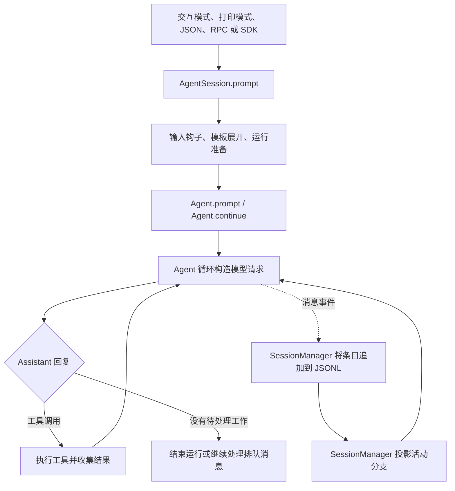

# Pi 的工作原理

> 本文为英文文档的简体中文译本；[查看英文原文](../how-pi-works.md)。

Pi 协调模型请求、工具执行、上下文组装和会话存储。会话是 Pi 对一次对话的记录，包含消息、工具调用及其结果、模型变更、上下文压缩和其他事件。

会话中的消息和事件组成一棵树。树中的每条路径都是一个分支。以当前条目结尾的分支是活动分支，它为下一次模型请求提供历史记录。

代码主路径是 [`AgentSession.prompt()`](../../src/core/agent-session.ts#L2177) → [`Agent.prompt()`](../../../agent/src/agent.ts#L382) → [`runAgentLoop()`](../../../agent/src/agent-loop.ts#L111)。会话层通过 [`SessionManager`](../../src/core/session-manager.ts#L987) 持久化 Agent 事件；后续请求从活动分支重新投影历史。

## Agent 循环

一次输入从 [`AgentSession.prompt()`](../../src/core/agent-session.ts#L2177) 开始：输入钩子先处理消息，随后展开 Skill 命令和提示模板；运行准备阶段再把文本和图像组成 user 消息。它调用 [`Agent.prompt()`](../../../agent/src/agent.ts#L382)，最终进入 [`runAgentLoop()`](../../../agent/src/agent-loop.ts#L111)。

每次请求由 [`streamAssistantResponse()`](../../../agent/src/agent-loop.ts#L390) 发出：它先应用上下文转换，再把 Pi 消息转换成模型 API 所需的格式，然后调用当前模型的流式接口。返回内容可以是文本、思考过程或工具调用。Pi 会执行工具、把结果写回上下文，再请求模型；没有待执行工具或排队消息时，这次运行才结束。工具执行入口是 [`executeToolCalls()`](../../../agent/src/agent-loop.ts#L518)。

Agent 循环区分两种排队消息：steering 会在当前 Assistant 轮次后加入上下文，follow-up 会等当前 Agent 工作完成后启动新一轮。中止会取消当前 Agent 运行；[`AgentSession.abort()`](../../src/core/agent-session.ts#L2616) 等待运行结束并完成会话层收尾。循环和队列处理在 [`runLoop()`](../../../agent/src/agent-loop.ts#L173) 与 [`AgentSession._startRun()`](../../src/core/agent-session.ts#L1958) 中衔接。

## 上下文

活动分支提供对话历史。`SessionManager` 从当前叶子沿父条目找到路径，再把会话条目投影成 Agent 消息；[`buildContextEntries()`](../../src/core/session-manager.ts#L476) 处理分支和压缩边界，[`buildSessionProjection()`](../../src/core/session-manager.ts#L545) 生成模型上下文。

系统提示由 [`buildSystemPromptSections()`](../../src/core/system-prompt.ts#L128) 组装，包含基础规则、活动工具说明、项目上下文文件、Skill 描述和工作目录。工具定义作为独立的请求字段随模型请求发送。请求准备和消息转换位于 [`agent-loop.ts`](../../../agent/src/agent-loop.ts#L390)；会话层把系统提示变更和消息历史一起同步到 Agent。

模型通常先看到 Skill 的名称、用途和文件位置；完整指令在需要时再通过工具读取。扩展可注册工具、输入处理器和生命周期事件，也可在请求前转换上下文；扩展注册入口见 [`loadExtensions()`](../../src/core/extensions/loader.ts#L746)。

提示模板会在编辑器输入成为 user 消息前展开。选中的文件、图像、粘贴的文本和 shell 输出可经由输入流程加入消息；对应的提示预处理在 [`AgentSession._preparePrompt()`](../../src/core/agent-session.ts#L2217) 中完成。

## 会话

持久化会话以 JSONL 文件保存：首行是会话头，后续每行是一个会话条目。条目通过 `id` 和 `parentId` 组成树，当前叶子决定活动分支。文件创建、读取和追加逻辑集中在 [`SessionManager`](../../src/core/session-manager.ts#L987)，消息由 [`appendMessage()`](../../src/core/session-manager.ts#L1224) 追加。

从较早条目继续会在同一棵树上产生新分支，旧条目仍然保留。分叉和克隆会将所选历史复制到新的会话文件中。活动分支由叶子沿 `parentId` 回溯得到，而不是简单地把文件里所有历史都发送给模型。

模型上下文会在运行时根据活动分支重新构建。压缩会追加摘要条目和保留范围；后续请求用摘要及保留的消息替代更早的上下文，但 JSONL 中的原始条目仍在。实现见 [`appendCompaction()`](../../src/core/session-manager.ts#L1280) 和 [`buildContextEntries()`](../../src/core/session-manager.ts#L476)。

## 接口

交互模式在终端呈现会话和 Agent 事件；打印模式处理提示并输出最终回复；JSON 模式以 JSONL 写出 Agent 事件。这些模式是不同的输入输出层，底层都使用 AgentSession 和 SessionManager。

RPC 模式从标准输入（stdin）接收 JSONL 命令，并向标准输出（stdout）写响应和事件。TypeScript SDK 也可在进程内创建和控制 Agent 会话。

各入口可在 [`interactive-mode.ts`](../../src/modes/interactive/interactive-mode.ts)、[`print-mode.ts`](../../src/modes/print-mode.ts)、[`json-event.ts`](../../src/modes/json-event.ts) 和 [`rpc-mode.ts`](../../src/modes/rpc/rpc-mode.ts) 中查看。它们共用的会话运行时在 [`agent-session.ts`](../../src/core/agent-session.ts) 中。

## 扩展与资源

扩展是加载到 Pi 进程中的 TypeScript 模块。扩展工厂函数可以注册工具、命令、快捷键、供应商、事件处理器、渲染器和终端 UI；注册 API 和资源加载由 [`extensions/loader.ts`](../../src/core/extensions/loader.ts) 提供。

Skill 提供按需加载的指令和配套文件。提示模板提供可复用的消息文本。主题提供终端配色。Pi 包通过 npm 或 git 分发这些资源。

## 信任与权限

Pi 会在加载项目设置和项目资源前解析项目是否可信；资源加载和上下文文件读取由 [`ResourceLoader`](../../src/core/resource-loader.ts) 管理。已启用的工具使用 Pi 进程的操作系统权限，扩展也在该进程内运行。因此，扩展和工具代码能访问的范围取决于启动 Pi 的操作系统账户及其权限。
