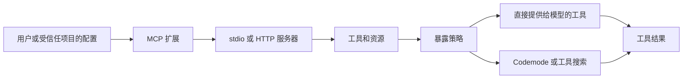

> 本文为简体中文译本；[查看英文原文](../mcp.md)。

<a id="mcp-servers"></a>
# MCP 服务器

Pi 通过 stdio 或可流式传输的 HTTP 连接到 [Model Context Protocol](https://modelcontextprotocol.io) 服务器，并将其工具和资源提供给模型。



内置扩展入口位于 [`index.ts`](vscode://file//Users/xuzh/git/pi/packages/coding-agent/src/extensions/mcp/index.ts:1:1)；服务器生命周期和传输处理在 [`runtime.ts`](vscode://file//Users/xuzh/git/pi/packages/coding-agent/src/extensions/mcp/runtime.ts:1:1)，工具注册在 [`tools.ts`](vscode://file//Users/xuzh/git/pi/packages/coding-agent/src/extensions/mcp/tools.ts:1:1)。

<a id="quick-setup"></a>
## 快速设置

添加一个本地 stdio 服务器，检查连接，然后启动 Pi：

```bash
pi mcp add filesystem -- npx -y @modelcontextprotocol/server-filesystem .
pi mcp list
pi
```

添加远程服务器：

```bash
pi mcp add docs --url https://example.com/mcp --bearer-token-env-var DOCS_TOKEN
pi mcp list
```

默认情况下，这些命令会添加用户级服务器。添加 `--local` 或 `-l` 可改为写入项目配置：

```bash
pi mcp add -l tools --env API_KEY='${TOOLS_KEY}' -- uvx tools-mcp
```

在交互式会话中使用 `/mcp` 可检查连接、登录、重新连接、更改暴露级别，或启用和禁用服务器。在会话外添加、移除或更改服务器后，运行 `/reload`。

<a id="configure-servers"></a>
## 配置服务器

Pi 从 `~/.pi/agent/mcp.json` 读取用户级服务器，从 `.pi/mcp.json` 读取项目服务器。只有在授予[项目目录信任](security.md#understand-project-trust)后才会读取项目配置。同名项目条目会替换用户级条目。

项目条目若没有 `command`、`url` 或 `type`，则只覆盖同名用户级服务器的 `enabled`、`exposure` 和 `toolExposure`，并保留其余配置，包括 `env`、`headers` 和 `auth`。例如，以下配置会在一个项目中关闭用户级服务器：

```json
{
  "mcpServers": {
    "internal-tools": { "enabled": false }
  }
}
```

配置格式与其他 MCP 客户端相同：

```json
{
  "mcpServers": {
    "filesystem": {
      "command": "npx",
      "args": ["-y", "@modelcontextprotocol/server-filesystem", "."]
    },
    "docs": {
      "url": "https://example.com/mcp",
      "headers": { "Authorization": "Bearer ${DOCS_TOKEN}" },
      "description": "Search and read the product documentation"
    }
  }
}
```

stdio 服务器使用 `command`、`args`、`env` 和 `cwd`。相对路径形式的 `cwd` 会相对于会话目录解析。`command`、参数或 `cwd` 中以 `~/` 开头的路径表示主目录。

HTTP 服务器使用 `url`、`headers` 和 `oauth`（参见[使用 OAuth 进行身份验证](#authenticate-with-oauth)）。不支持旧版 SSE 传输。

两种服务器都支持以下选项：

- `timeout`：每个请求的超时时间，单位为秒（默认值为 60）。进度通知会重置计时。
- `enabled: false`：保留该条目，但不连接服务器。
- `exposure` 和 `toolExposure`：控制工具如何提供给模型（参见[控制工具暴露方式](#control-tool-exposure)）。
- `description`：用一句话描述服务器提供的功能。该描述会在系统提示中列出服务器（参见[控制工具暴露方式](#control-tool-exposure)），供工具搜索据此排列服务器工具，也会由 codemode 的 `describeNamespace()` 返回。如果未设置，服务器连接后会使用其指令的第一行。

将个人服务器和带有凭据的服务器保存在用户级文件中。项目文件只用于项目所需的服务器，并且只在可信项目中使用。

<a id="configuration-rules"></a>
### 配置规则

- 服务器名称只能包含字母、数字、`_` 和 `-`。工具名称格式为 `mcp__<server>__<tool>`；除字母、数字和 `_` 以外的字符都会替换为 `_`。如果同一服务器的多个工具因此产生同名，都会加上哈希后缀。只在 `-` 和 `_` 上有差异的服务器名称会被视为同一个服务器：第二个服务器会被拒绝，且 `mcp.json` 中的服务器会覆盖已注册的服务器。
- `type` 为可选项。设置 `command` 会选择 stdio，设置 `url` 会选择可流式传输的 HTTP。如果设置了 `type`，其值必须为 `stdio`、`http` 或 `streamable-http`。
- `sse` 会被拒绝。文档中提供 SSE 端点的服务器通常也提供可流式传输的 HTTP，常见端点是 `/mcp` 而不是 `/sse`。
- `command` 是一个可执行文件，`args` 存放其参数；`command` 不是一整条 shell 命令字符串。
- `env` 和 `headers` 的值可以使用 `${GITHUB_TOKEN}` 之类的环境变量。也可以用 `!command` 执行命令，但命令必须占据整个值，例如 `"Authorization": "!echo Bearer $(gh auth token)"`。
- 无效条目会报告并跳过，不会妨碍其他服务器连接。

可在 shell 中使用 `pi mcp add` 和 `pi mcp remove` 完成常见更改。可用选项见 [MCP 命令](../cli.md#mcp-commands)。

<a id="inspect-or-change-a-server"></a>
### 检查或更改服务器

`/mcp` 会列出已配置服务器的状态、工具数量、暴露级别和配置来源。需要处理的服务器会排在前面。选择服务器可查看其工具和连接详情、重新连接、登录或退出、更改暴露级别，或启用和禁用服务器。

更改暴露级别和启用状态时，Pi 会将更改保存到定义该服务器的文件中，而不替换无关内容。在可信项目中，“在此项目中启用”和“在此项目中禁用”会为用户级服务器添加项目覆盖项；之后对该服务器的更改会保存到此覆盖项中。已禁用的服务器仍会列出。在交互式 TUI 之外，`/mcp` 会打印服务器状态；`/mcp login <server>`、`/mcp logout <server>` 和 `/mcp reconnect <server>` 可直接执行相应操作。

无需启动会话即可使用 shell 命令：`pi mcp add`、`pi mcp remove`、`pi mcp list`、`pi mcp login` 和 `pi mcp logout`。Shell 命令不会加载扩展。

<a id="diagnose-connection-problems"></a>
### 诊断连接问题

运行 `pi mcp list` 会连接所有已启用的服务器，并打印其状态、工具和错误。如果条目无效或有已启用的服务器未连接，命令会以状态码 1 退出。`/mcp` 会显示完整连接错误，以及 stdio 服务器连接失败时 stderr 的末尾内容。

Pi 会在启动后一次性报告配置错误、连接失败和需要登录的情况。服务器日志通知会追加到 `~/.pi/agent/mcp.log`，格式为 `<time> [<server>] <level> <logger>: <message>`。文件超过 5 MB 后会移至 `mcp.log.1`。

会话启动时，Pi 会在后台连接所有已启用的服务器。服务器连接后，其工具便会出现；codemode 描述不会列出这些工具，因此不会随服务器连接而改变。首次提示最多等待 10 秒，但只等待具有 `direct` 工具的服务器，因为这些工具必须在请求中声明。其他服务器会在需要时等待：codemode 脚本会等待脚本中指定的服务器（`mcp__<server>`）；如果脚本调用 `searchTools()` 或读取 `ALL_TOOLS`，则会等待所有服务器；`tool_search` 和资源工具也会等待所有服务器。HTTP 网络错误及暂时性状态码（408、429 和 5xx）会重试两次。连接中断时会显示为已断开，并在下一次调用时重新连接。服务器通知工具列表发生变化后，Pi 会添加新工具，并使已撤回的工具无法再访问。

停止 stdio 服务器时，Pi 会关闭其 stdin，发送 SIGTERM，然后向其进程组发送 SIGKILL。这也会停止通过 `npx` 或 `uvx` 等包装器启动的服务器。

<a id="migrate-configuration-from-another-client"></a>
## 从其他客户端迁移配置

将转换后的条目移入 `mcp.json` 的 `mcpServers` 下，然后运行 `pi mcp list` 验证配置。

| 客户端 | 转换方式 |
|---|---|
| Claude Desktop、Claude Code 或 Cursor | 复制现有的 `mcpServers` 条目。 |
| VS Code | 将条目从顶层 `servers` 对象移出，并将 `${input:...}` 提示替换为 `${NAME}` 环境变量。 |
| Codex | 将 `[mcp_servers.<name>]` 中的 `command`、`args`、`env` 和 `url` 等 TOML 字段转换为 JSON。 |
| OpenCode | 将 `"type": "local"` 转换为 stdio 条目，将 `command` 数组拆分为 `command` 和 `args`，把 `environment` 重命名为 `env`，并将 `{env:NAME}` 替换为 `${NAME}`。将 `"type": "remote"` 转换为 URL 条目。 |

<a id="authenticate-with-oauth"></a>
## 使用 OAuth 进行身份验证

使用 OAuth 的远程服务器（例如 Sentry）无需在 `mcp.json` 中配置凭据：

```json
{
  "mcpServers": {
    "sentry": { "url": "https://mcp.sentry.dev/mcp" }
  }
}
```

服务器拒绝未通过身份验证的连接时，`/mcp` 会显示需要登录。选择“登录”，运行 `/mcp login sentry`，或运行 `pi mcp login sentry`。Pi 会打开授权页面并等待批准。如果浏览器运行在另一台机器上（例如通过 SSH 连接），请将浏览器重定向后的 URL 粘贴到登录界面。运行中的会话会在下一轮使用新凭据。

Pi 使用客户端 ID 元数据文档（Client ID Metadata Document）向授权服务器标识自身，或通过注册客户端来标识自身；令牌存储在 `~/.pi/agent/mcp-auth.json` 中，并会在访问令牌过期或服务器拒绝令牌时刷新。如果服务器之后要求额外的 scope，Pi 会再次要求登录。退出登录会删除已存储的凭据。

凭据与服务器名称和 URL 绑定。同一 URL 使用不同名称的服务器（例如每个账户各配置一个服务器）需要分别登录；不同 `mcp.json` 文件中名称和 URL 均相同的服务器则共用一次登录。

OAuth 适用于未设置 `Authorization` 标头的 HTTP 服务器。对于不支持动态客户端注册的服务器，请配置已注册的客户端：

```json
{
  "mcpServers": {
    "example": {
      "url": "https://mcp.example.com/mcp",
      "oauth": { "clientId": "my-client", "clientSecret": "${EXAMPLE_SECRET}", "callbackPort": 8765 }
    }
  }
}
```

重定向 URI 必须与已注册的 URI 相符。`callbackPort` 使用 `http://127.0.0.1:<port>/callback`。若要使用其他 URI，请设置 `callbackUrl`；它必须使用 HTTP，主机名为 `localhost`、`127.0.0.1` 或 `[::1]`。Pi 会原样发送该 URI。`callbackUrl` 未指定端口时，Pi 会使用 `callbackPort` 或一个空闲端口，并将其添加到 URI；RFC 8252 允许回环重定向这样做。`clientSecret` 为可选项，可使用环境变量或命令。

对于未公布所需 scope 的服务器，请将 `scope` 设置为空格分隔的列表。否则，Pi 会请求服务器公布的 scope。之后新增的 scope 请求会合并到已配置的值中。

Pi 注册时使用的名称为 `pi`。有些服务器只接受来自已知客户端的注册。设置 `clientName` 可发送其他名称：

```json
{
  "mcpServers": {
    "figma": { "url": "https://mcp.figma.com/mcp", "oauth": { "clientName": "Claude Code" } }
  }
}
```

只有 Pi 注册客户端时才会发送该名称。若要使用新名称重新注册，请先退出登录。

未设置 `clientId` 时，如果授权服务器声明支持元数据文档和公共客户端，Pi 会使用 pi.dev 上的客户端 ID 元数据文档标识自身；否则会动态注册客户端。只要重定向 URI 相符，之前注册的客户端就会继续使用，直到退出登录。使用该文档时，客户端 ID 为 `https://pi.dev/oauth/client.json`，重定向 URI 为 `http://127.0.0.1:<port>/callback`。如果授权服务器在授权响应中未发送 `iss` 参数（RFC 9207），Pi 会改用专属于该 MCP 服务器的文档和重定向路径：`https://pi.dev/oauth/<id>/client.json` 和 `http://127.0.0.1:<port>/callback/<id>`。

设置了 `clientName`，或 `callbackUrl` 在 `localhost` 或 `127.0.0.1` 上使用的路径不是 `/callback` 时，Pi 会注册客户端，而不使用该文档。设置 `clientRegistration` 可选择注册方式：`auto`（默认值）按上述规则自动选择，`dcr` 始终注册客户端，`cimd` 始终使用该文档。使用 `cimd` 时，如果授权服务器不支持公共客户端的元数据文档，登录会失败。如果授权页面报告客户端无效，请使用 `dcr`：

```json
{
  "mcpServers": {
    "example": { "url": "https://mcp.example.com/mcp", "oauth": { "clientRegistration": "dcr" } }
  }
}
```

添加服务器时，可用 `pi mcp add --oauth-client-registration <mode>` 设置注册方式。`cimd` 不能与 `clientId` 或 `clientName` 同时使用；`callbackUrl` 必须使用 `localhost` 或 `127.0.0.1`，且路径必须为 `/callback`。

Pi 通过服务器的受保护资源元数据（RFC 9728）查找授权服务器，并检查授权服务器的元数据是否将预期颁发者列为名称（RFC 8414）。有些服务器公布了错误的授权服务器，或完全未公布，因此登录时会打开不存在的页面。请将 `authServerMetadataUrl` 设置为正确授权服务器的元数据文档：

```json
{
  "mcpServers": {
    "example": {
      "url": "https://mcp.example.com/mcp",
      "oauth": { "authServerMetadataUrl": "https://example.okta.com/.well-known/openid-configuration" }
    }
  }
}
```

Pi 会使用该文档而不是执行发现流程，并信任配置中的文档，因此只能指定你信任的文档。URL 必须使用 HTTPS；`localhost`、`127.0.0.1` 或 `[::1]` 除外。

<a id="control-tool-exposure"></a>
## 控制工具暴露方式

每个服务器工具都会注册为 `mcp__<server>__<tool>`。服务器的 `exposure` 决定模型如何访问该工具：

| 暴露级别 | 行为 | 典型用途 |
|---|---|---|
| `codemode`（默认值） | 可从 [`codemode`](../cli.md#tools) 脚本调用，但不会声明给模型，也不会列在 codemode 描述中。脚本可通过 `searchTools()`、`describeTool()` 或 `ALL_TOOLS` 查找工具。 | 通用 MCP 服务器，尤其适用于脚本需要组合或筛选调用的场景。 |
| `deferred` | 在 [`tool_search`](../cli.md#tools) 为下一次模型调用加载匹配项之前，不会声明给模型。 | 工具数量较多，且希望在发现后直接调用的服务器。 |
| `direct` | 像内置工具一样声明给模型，也可从 codemode 调用。 | 工具数量较少、经常使用的工具集。 |
| `hidden` | 已注册，但无法访问。 | 应保持不可用的服务器或工具。 |

`codemode-deferred` 可作为 `codemode` 的别名。

带有 `codemode` 或 `deferred` 工具的服务器会列在系统提示的 `mcp_servers` 部分，其中会说明工具的访问方式，以及一行来自已配置 `description` 的内容，或服务器连接后的一行服务器指令。开始提示时，Pi 会在等待带有 `direct` 工具的服务器后更新该部分。如果内容发生变化（例如服务器刚刚连接且其摘要已可用），Pi 会将新部分追加到对话中，而不是更改工具声明，这样之前的消息仍可缓存。`describeNamespace()` 和 `searchTools()` 的 `namespace` 选项接受 `mcp__dev-radius`、`mcp__dev_radius`、`dev-radius` 或 `dev_radius`。

具有 `codemode` 暴露级别的服务器连接后，Pi 会启用 `codemode`。具有 `deferred` 暴露级别的服务器连接后，Pi 会启用 `tool_search`。若要让模型无需搜索即可看到工具，请通过 `toolExposure` 将该工具设为 `direct`。

`toolExposure` 可覆盖服务器级别的暴露设置，为单个工具指定暴露级别。键可以是精确的服务器工具名称，也可以是用 `*` 匹配任意字符的模式。精确名称优先于模式；多个模式匹配时，以第一个匹配项为准。暴露级别为 `hidden` 的服务器也可以只暴露选定的工具：

```json
{
  "mcpServers": {
    "github": {
      "url": "https://api.githubcopilot.com/mcp/",
      "exposure": "deferred",
      "toolExposure": {
        "search_code": "direct",
        "get_*": "codemode",
        "delete_*": "hidden"
      }
    }
  }
}
```

`pi mcp list` 会标出暴露级别与服务器不同的工具。`/mcp` 中的 Tools 视图也会显示工具的有效暴露级别。

暴露级别为 `codemode` 或 `deferred` 的工具可通过两种间接方式访问：codemode 脚本可以调用它们，`tool_search` 也可以加载它们。Codemode 调用不依赖当前启用的工具集，因此在 `/tree`、恢复会话和分叉会话后仍可使用。由 `tool_search` 加载的工具会记录在对话记录中，并继续声明在该分支上。

除非 `--tools` 中某个条目以 `mcp__` 开头，否则该选项不会移除 MCP 工具；`pi --tools read,codemode,'mcp__radius__*'` 会仅保留 `radius` 的工具。`--exclude-tools` 接受相同的模式，`--no-mcp` 会在单次运行中禁用 MCP（参见[工具](../cli.md#mcp-tools)）。

若要在没有 MCP 服务器时仍保持 `codemode` 启用，请将 `"defaultTools": ["+codemode"]` 添加到[设置](settings.md#tools)。若要阻止自动启用 codemode，请在 `mcpServers` 旁设置 `"autoEnableCodemode": false`。项目中的值会覆盖用户级值。如果 `codemode` 和 `tool_search` 均未启用，且无法调用非 `direct` 工具，Pi 会发出一次警告。

超过 20 KB 的文本结果传给模型时，会在 `…N chars truncated…` 标记处删去中间部分。完整文本会保存到结果中注明的临时文件。Codemode 脚本会收到完整结果，并可在将输出返回给模型前对其进行精简。

Codemode 脚本会收到完整的 MCP `CallToolResult`，包括 `content`、`structuredContent` 和 `isError`。含有 `isError` 的结果在脚本中会正常解析，但直接调用时会作为错误报告。`image(result.content[0])` 会转发图像块。服务器指令不会包含在任何工具描述中；脚本可通过 `describeNamespace("mcp__<server>")` 读取服务器指令，该调用也会返回服务器的工具名称。

<a id="use-resources"></a>
## 使用资源

连接的服务器提供[资源](https://modelcontextprotocol.io/specification/2025-11-25/server/resources)时，Pi 会添加 Codex 和 OpenCode 使用的资源工具：

- `list_mcp_resources` 以 JSON 列出资源：`{ server?, resources: [{ server, uri, name, ... }], nextCursor? }`。指定 `server` 时会列出一页；使用 `cursor` 可继续读取下一页。不指定 `server` 时会列出所有服务器的所有资源。
- `list_mcp_resource_templates` 列出服务器未直接列出的资源 URI 模板。
- `read_mcp_resource` 根据 `server` 和 `uri` 读取资源。文本会以文本形式提供给模型，图像会以图像形式提供。其他二进制资源会保存到临时文件，并将文件路径提供给模型。脚本会收到 `{ server, uri, contents }`。

这些工具会访问所有已启用且未隐藏、并提供资源的服务器。资源工具的暴露级别是这些服务器中最高的暴露级别：`direct` 优先于 `codemode` 或 `deferred`。工具结果中的资源链接会标明 `read_mcp_resource` 和服务器名称。

MCP Apps 的资源（以 `ui://` URI 或 `text/html;profile=mcp-app` 标识）会被省略，因为 Pi 不会渲染这些资源。资源图标也会被省略。

读取和列出资源时，如果遇到暂时性 HTTP 错误（408、429 或 5xx），会重试一次。工具调用不会重试，因为服务器可能已经执行了调用。

<a id="permissions"></a>
## 权限

每次 MCP 调用都会经过 Pi 的工具流水线。因此，扩展的 `tool_call` 和 `tool_result` 处理器（包括权限门控）也适用于 MCP 工具。通过 codemode 脚本发出的调用会携带 codemode 调用 ID 作为 `parentToolCallId`。

`pi.getAllTools()` 会报告每个服务器声明的注解：`readOnlyHint`、`destructiveHint`、`idempotentHint` 和 `openWorldHint`。权限扩展可以使用这些提示判断哪些调用需要确认（参见[工具暴露方式](extensions.md#tool-exposure)）。资源工具会标记为只读。

<a id="extensions-and-sdk"></a>
## 扩展与 SDK

<a id="add-servers-from-extensions"></a>
### 从扩展添加服务器

扩展可以通过 `pi.registerMcpServer(name, config)` 为当前会话添加服务器，所用配置结构与 `mcpServers` 条目相同（参见[扩展中的 MCP 服务器](extensions.md#mcp-servers)）。已注册的服务器会像已配置服务器一样连接，并在 `/mcp` 中以该扩展为来源显示。

启用状态或暴露级别的更改只对当前会话生效。同名的文件配置服务器优先级更高，`/mcp` 会列出被覆盖的注册项。`pi mcp` shell 命令不会加载扩展，只能看到文件配置的服务器。

<a id="replace-the-built-in-mcp-support"></a>
### 替换内置 MCP 支持

已安装且注册了 `/mcp` 的扩展（例如 `pi-mcp-adapter`）会替换会话的内置 MCP 支持。此时 Pi 不会在会话中读取 `mcp.json` 或连接其中的服务器，`/mcp` 也由该扩展提供。移除扩展即可恢复内置行为。若要在没有替代扩展的情况下禁用内置 MCP 支持，请在 `pi config` 的 Built-in 下禁用 `mcp`，或在[设置](settings.md#resources)中设置 `"extensions": ["-builtin:mcp"]`。`--no-mcp` 会在单次运行中禁用 MCP。

若扩展注册了 `codemode` 或 `tool_search`，同样会替换同名的内置工具。Pi 会为 MCP 服务器启用替代工具，并且仅在该工具声明了 [`reachesTools`](extensions.md#tool-exposure) 时，才等待其调用所需的服务器。Shell 层级的 `pi mcp` 命令始终使用内置实现。

<a id="use-mcp-from-the-sdk"></a>
### 在 SDK 中使用 MCP

SDK 会话不会加载内置扩展。请将 MCP 扩展、供 `codemode` 服务器使用的 codemode 扩展，以及供 `deferred` 服务器使用的工具搜索扩展添加到资源加载器中。参见 [Codemode 和 MCP](sdk.md#codemode-mcp)。
