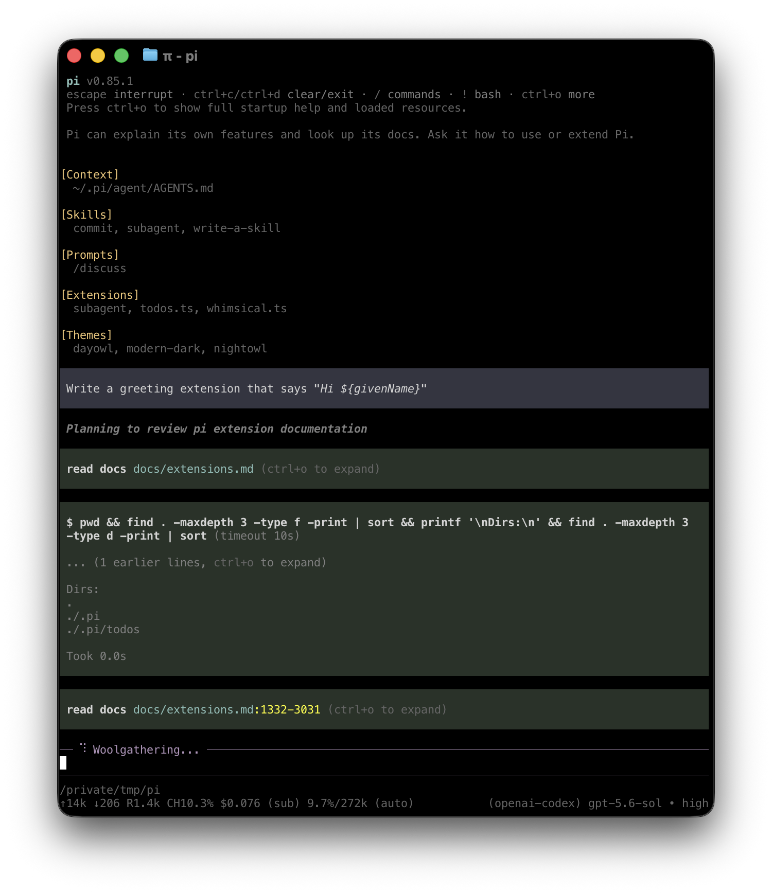

> 本文为简体中文译本；[查看英文原文](../quickstart.md)。

# 快速入门

Pi 在终端中运行，并可处理你电脑上的文件。使用 Pi 需要通过受支持的供应商访问模型，可以使用订阅、API 密钥或本地模型。

原生 Windows 安装请阅读 [Windows 安装](windows.md)；Android 请阅读 [Termux 安装](termux.md)。

## 1. 安装 Pi

在 macOS、Linux 或 Windows 上使用安装程序安装 Pi：

```bash tab="macOS / Linux"
curl -fsSL https://pi.dev/install.sh | sh
```

```powershell tab="Windows"
powershell -c "irm https://pi.dev/install.ps1 | iex"
```

这两种安装程序都会固定所有依赖，并可通过 `pi update` 更新 Pi。你也可以从 npm 安装 Pi，但传递依赖不会固定。此方式要求 Node.js 22.19 或更高版本：

```bash
npm install -g --ignore-scripts @earendil-works/pi-coding-agent
```

常规 npm 安装 Pi 不需要执行依赖生命周期脚本。

在 macOS 或 Linux 上使用 Nix 时，可从 Pi 的 flake 安装最新版本。Nix 会从源代码构建 Pi：

```bash
nix profile add github:earendil-works/pi/stable
```

旧版 Nix 使用 `nix profile install`。使用 `nix profile upgrade pi` 更新；`pi update` 不能更新 Nix 安装。若要固定到某个版本，可使用标签，例如 `github:earendil-works/pi/v1.0.0`。

验证安装：

```bash
pi --version
```

## 2. 启动 Pi

切换到希望 Pi 操作的文件夹，然后启动：

```bash
cd /path/to/folder
pi
```

工作文件夹有助于 Pi 发现相关文件、指令和配置。Pi 也会用它对保存的会话进行分组。

<p align="center"></p>

界面会显示对话、用于输入提示和命令的编辑器，以及显示当前文件夹、模型和会话状态的页脚。有关添加文件、运行命令、引导持续工作和管理结果的说明，请参阅[在终端中使用 Pi](usage.md)。

## 3. 选择模型

**模型**用于生成 Pi 的回复。**供应商**是 Pi 用来访问该模型的服务或账号。

在 Pi 中运行：

```text
/login
```

选择供应商，然后按提示使用订阅或保存 API 密钥。之后可运行 `/model`，选择其他可用模型。

有关受支持供应商、环境变量认证、本地模型和自定义端点，请参阅[选择模型和供应商](models.md)。

## 4. 给 Pi 分配任务

Pi 会显示它执行的每次文件读取、搜索、命令和编辑，但不会在每次调用工具前都征求确认。

输入与你的工作相符的任务，例如：

```text
Summarize @meeting-notes.md and save the action items to action-items.md.
```

```text
Explain how this repository is structured and how to run its checks.
```

```text
Compare @previous.csv with @current.csv and summarize the important changes.
```

在编辑器中输入 `@` 可搜索文件，无需输入完整路径。Pi 完成后，请检查它的回复和所有修改过的文件。重要工作请使用版本控制或备份。对于不可信或无人值守的任务，请使用容器或其他沙箱。请参阅[安全运行 Pi](security.md)。

## 之后继续

Pi 会自动保存会话。退出 Pi 后，可在相同工作文件夹中用以下命令恢复最近的会话：

```bash
pi --continue
```

使用 `/resume` 选择其他已保存的会话。有关会话命名、分支、压缩、导出和分享，请参阅[继续会话或创建分支](sessions.md)。

## 后续阅读

- [交互式使用 Pi](usage.md)：了解输入、命令、快捷键和排队消息。
- [添加指令](configuration.md#context-files)：为 Pi 在某个文件夹中工作时设定持续生效的指令。
- [选择模型和供应商](models.md)。

### 选择 Pi 的自定义方式

从满足需求的最简单机制开始：

| 需求 | 从这里开始 |
|---|---|
| 为 Pi 在某个文件夹中的工作提供持久指令 | [`AGENTS.md`](configuration.md#context-files) |
| 在 `/` 菜单中重复使用提示 | [提示模板](prompt-templates.md) |
| 添加特定任务的指令和配套文件 | [技能](skills.md) |
| 添加可执行工具、命令或事件处理器 | [扩展](extensions.md) |
| 构建自定义终端组件 | [终端 UI](tui.md) |
| 连接尚未支持的模型服务 | [自定义供应商](custom-provider.md) |
| 安装或分发多个资源 | [Pi 包](packages.md) |

## 卸载 Pi

如果通过 npm 安装 Pi，请运行：

```bash
npm uninstall -g @earendil-works/pi-coding-agent
```

如果使用安装程序，请再次运行并选择 **Uninstall Pi**：

```bash
curl -fsSL https://pi.dev/install.sh | sh
```

如果通过 Nix 安装，请运行：

```bash
nix profile remove pi
```

以上方法都不会删除 `~/.pi/agent/` 中的配置、凭据、会话或已安装的 Pi 包。
